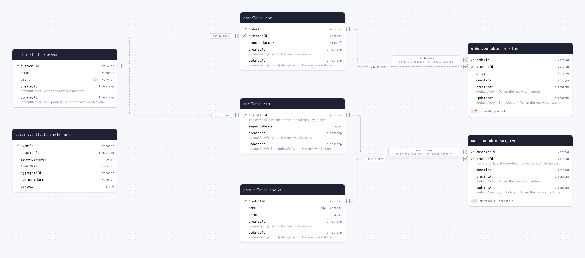

# examples/layered

A schema laid out as layered (hexagonal) backends often keep it: one table per `*.sql.ts` under
`src/adapter/secondary/persistence/rdb/schema`, tables built with `snakeCase.table` and exported
in a list, shared columns in `columns.helpers.ts` imported through the tsconfig path `#/*`, and a
`relations.sql.ts` that declares with `defineRelations` the relations the database has no foreign
key for.

```sh
pnpm -F @examples/layered generate
```

drizzler reads the `schema` glob of `drizzle.config.ts`, follows the imports to the helper, and
writes `docs/`. Only `cart_item → cart` and `order_item → order` are foreign keys, drawn solid;
the relations only `defineRelations` declares are dashed, and `customer → cart` is a one-to-one,
since the cart's key is its customer's.


