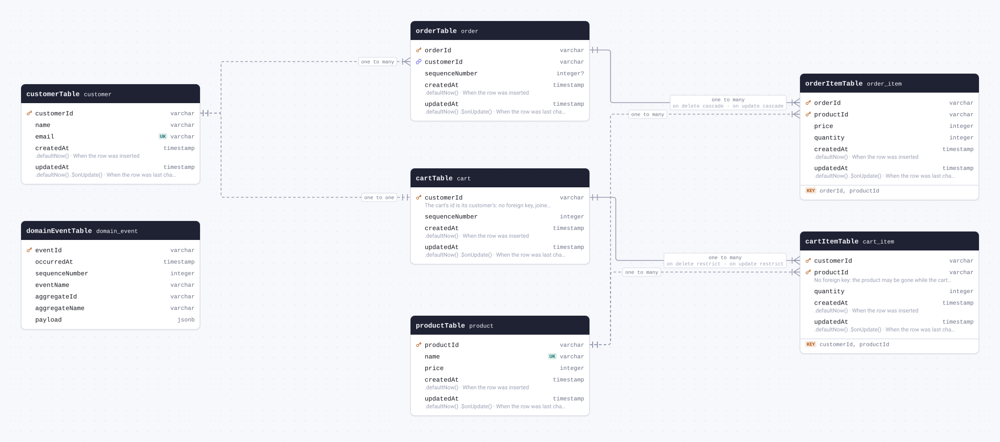
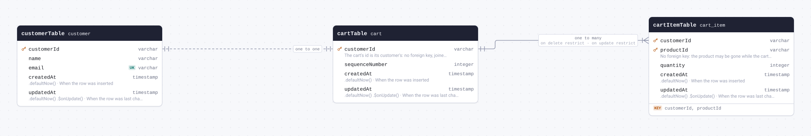
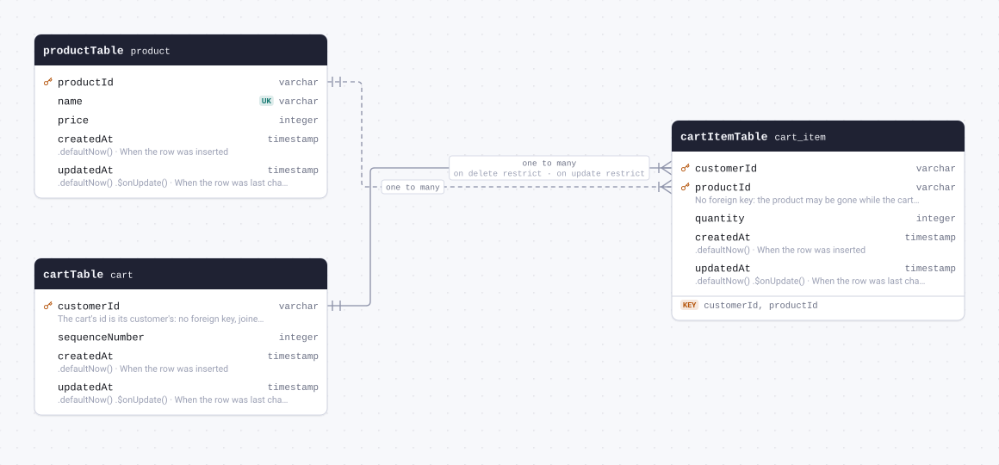
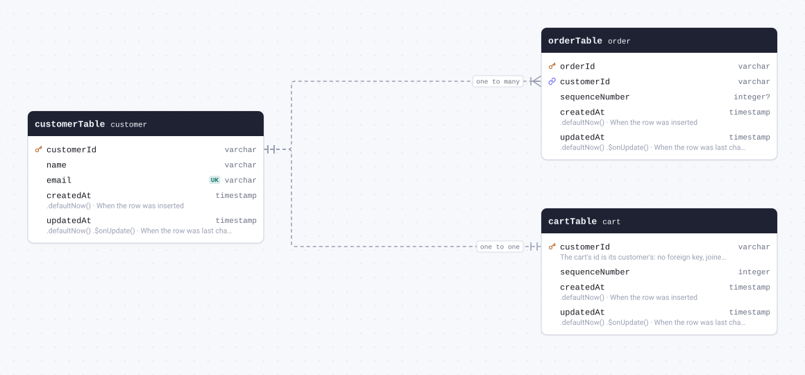
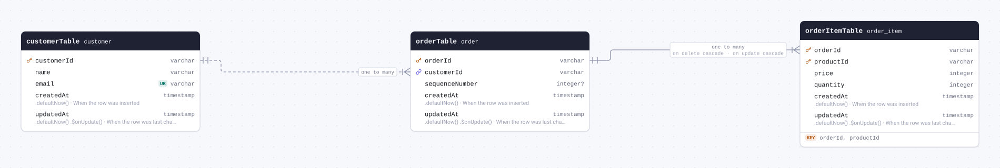
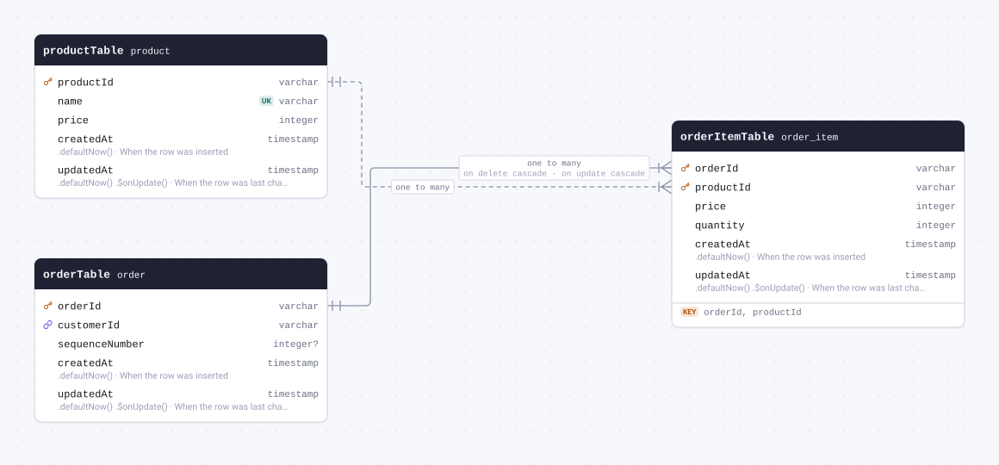
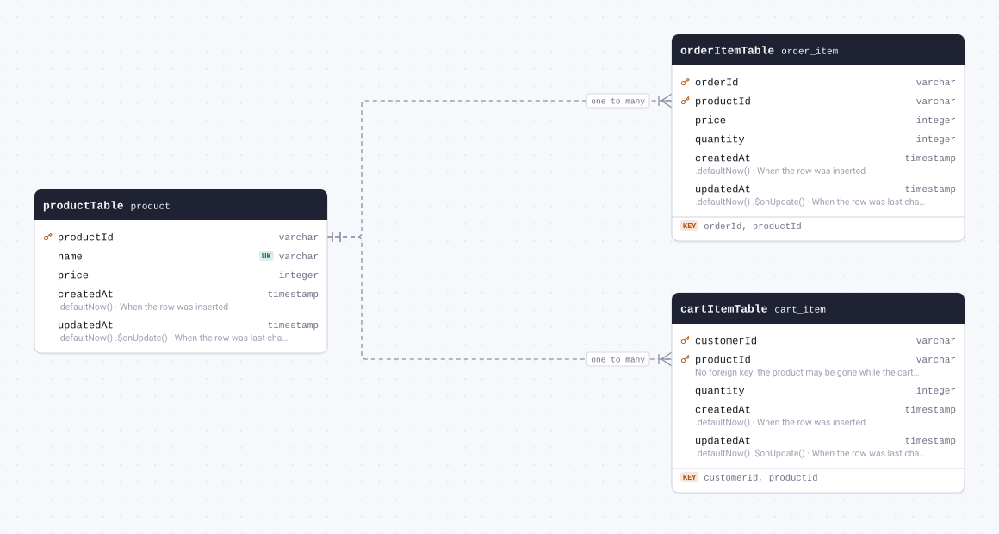

# Schema docs



<details>
<summary>The whole schema as SQL</summary>

```sql
CREATE TABLE "cart" (
	"customer_id" varchar(26) PRIMARY KEY,
	"sequence_number" integer NOT NULL,
	"created_at" timestamp with time zone DEFAULT now() NOT NULL,
	"updated_at" timestamp with time zone DEFAULT now() NOT NULL
);

CREATE TABLE "cart_item" (
	"customer_id" varchar(26),
	"product_id" varchar(26),
	"quantity" integer NOT NULL,
	"created_at" timestamp with time zone DEFAULT now() NOT NULL,
	"updated_at" timestamp with time zone DEFAULT now() NOT NULL,
	CONSTRAINT "cart_item_pkey" PRIMARY KEY("customer_id","product_id")
);

CREATE TABLE "customer" (
	"customer_id" varchar(26) PRIMARY KEY,
	"name" varchar(100) NOT NULL,
	"email" varchar(255) NOT NULL UNIQUE,
	"created_at" timestamp with time zone DEFAULT now() NOT NULL,
	"updated_at" timestamp with time zone DEFAULT now() NOT NULL
);

CREATE TABLE "domain_event" (
	"event_id" varchar(26) PRIMARY KEY,
	"occurred_at" timestamp with time zone NOT NULL,
	"sequence_number" integer NOT NULL,
	"event_name" varchar(50) NOT NULL,
	"aggregate_id" varchar(26) NOT NULL,
	"aggregate_name" varchar(50) NOT NULL,
	"payload" jsonb NOT NULL
);

CREATE TABLE "order" (
	"order_id" varchar(26) PRIMARY KEY,
	"customer_id" varchar(26) NOT NULL,
	"sequence_number" integer,
	"created_at" timestamp with time zone DEFAULT now() NOT NULL,
	"updated_at" timestamp with time zone DEFAULT now() NOT NULL
);

CREATE TABLE "order_item" (
	"order_id" varchar(26),
	"product_id" varchar(26),
	"price" integer NOT NULL,
	"quantity" integer NOT NULL,
	"created_at" timestamp with time zone DEFAULT now() NOT NULL,
	"updated_at" timestamp with time zone DEFAULT now() NOT NULL,
	CONSTRAINT "order_item_pkey" PRIMARY KEY("order_id","product_id")
);

CREATE TABLE "product" (
	"product_id" varchar(26) PRIMARY KEY,
	"name" varchar(100) NOT NULL CONSTRAINT "product_name_unique" UNIQUE,
	"price" integer NOT NULL,
	"created_at" timestamp with time zone DEFAULT now() NOT NULL,
	"updated_at" timestamp with time zone DEFAULT now() NOT NULL
);

ALTER TABLE "cart_item" ADD CONSTRAINT "cart_item_customer_id_cart_customer_id_fkey" FOREIGN KEY ("customer_id") REFERENCES "cart"("customer_id") ON DELETE RESTRICT ON UPDATE RESTRICT;

ALTER TABLE "order_item" ADD CONSTRAINT "order_item_order_id_order_order_id_fkey" FOREIGN KEY ("order_id") REFERENCES "order"("order_id") ON DELETE CASCADE ON UPDATE CASCADE;
```

</details>

## Contents

| Table                                       | Name in the database | Description                                   |
| ------------------------------------------- | -------------------- | --------------------------------------------- |
| [cartTable](#table-cartTable)               | `cart`               | A customer's cart, one per customer           |
| [cartItemTable](#table-cartItemTable)       | `cart_item`          | A line of a cart                              |
| [customerTable](#table-customerTable)       | `customer`           | Someone who shops                             |
| [domainEventTable](#table-domainEventTable) | `domain_event`       | Every event an aggregate raised, in order     |
| [orderTable](#table-orderTable)             | `order`              | An order placed from a cart                   |
| [orderItemTable](#table-orderItemTable)     | `order_item`         | A line of an order, priced when it was placed |
| [productTable](#table-productTable)         | `product`            | What is for sale                              |

## Tables

<a id="table-cartTable"></a>

### cartTable

Table `cart`. A customer's cart, one per customer



| Column           | Type        | Constraints                                                    | Default                        | Description                                                                |
| ---------------- | ----------- | -------------------------------------------------------------- | ------------------------------ | -------------------------------------------------------------------------- |
| `customerId`     | `varchar`   | PK NOT NULL → [customerTable.customerId](#table-customerTable) |                                | The cart's id is its customer's: no foreign key, joined in the application |
| `sequenceNumber` | `integer`   | NOT NULL                                                       |                                |                                                                            |
| `createdAt`      | `timestamp` | NOT NULL                                                       | `.defaultNow()`                | When the row was inserted                                                  |
| `updatedAt`      | `timestamp` | NOT NULL                                                       | `.defaultNow()` `.$onUpdate()` | When the row was last changed                                              |

#### Definition

```sql
CREATE TABLE "cart" (
	"customer_id" varchar(26) PRIMARY KEY,
	"sequence_number" integer NOT NULL,
	"created_at" timestamp with time zone DEFAULT now() NOT NULL,
	"updated_at" timestamp with time zone DEFAULT now() NOT NULL
);
```

#### References

- `customerId` → [customerTable.customerId](#table-customerTable) (one to one, defineRelations, no foreign key)

#### Referenced by

- `customerId` → [cartItemTable.customerId](#table-cartItemTable) (one to many, on delete restrict, on update restrict)

<details>
<summary>Queries and their SQL</summary>

**Select**: Every row of cartTable.

```ts
db.select().from(cartTable);
```

```sql
select "customer_id", "sequence_number", "created_at", "updated_at"
from "cart"
```

**Count**: How many rows cartTable has.

```ts
db.select({ count: count() }).from(cartTable);
```

```sql
select count(*)
from "cart"
```

**Find many with relations**: The rows of cartTable with what they relate to, through the relational query API.

```ts
db.query.cartTable.findMany({ with: { customer: true, items: true } });
```

```sql
select "d0"."customer_id" as "customerId", "d0"."sequence_number" as "sequenceNumber", "d0"."created_at" as "createdAt", "d0"."updated_at" as "updatedAt", "customer"."r" as "customer", "items"."r" as "items"
from "cart" as "d0"
left join lateral(select row_to_json("t".*) "r" from (select "d1"."customer_id" as "customerId", "d1"."name" as "name", "d1"."email" as "email", "d1"."created_at" as "createdAt", "d1"."updated_at" as "updatedAt" from "customer" as "d1" where "d0"."customer_id" = "d1"."customer_id" limit $1) as "t") as "customer" on true
left join lateral(select coalesce(json_agg(row_to_json("t".*)), '[]') as "r" from (select "d1"."customer_id" as "customerId", "d1"."product_id" as "productId", "d1"."quantity" as "quantity", "d1"."created_at" as "createdAt", "d1"."updated_at" as "updatedAt" from "cart_item" as "d1" where "d0"."customer_id" = "d1"."customer_id") as "t") as "items" on true
-- params: [1]
```

**Find by primary key**: One row of cartTable, through the relational query API.

```ts
db.query.cartTable.findFirst({ where: { customerId: "customerId" } });
```

```sql
select "d0"."customer_id" as "customerId", "d0"."sequence_number" as "sequenceNumber", "d0"."created_at" as "createdAt", "d0"."updated_at" as "updatedAt"
from "cart" as "d0"
where "d0"."customer_id" = $1
limit $2
-- params: ["customerId",1]
```

**Insert**: Adds a row to cartTable, giving the columns that have no default.

```ts
db.insert(cartTable).values({ customerId: "customerId", sequenceNumber: 1 });
```

```sql
insert into "cart" ("customer_id", "sequence_number", "created_at", "updated_at")
values ($1, $2, default, default)
-- params: ["customerId",1]
```

**Update**: Changes a row of cartTable, found by its primary key.

```ts
db.update(cartTable).set({ sequenceNumber: 1 }).where(eq(cartTable.customerId, "customerId"));
```

```sql
update "cart"
set "sequence_number" = $1, "updated_at" = $2
where "cart"."customer_id" = $3
-- params: [1,"2026-01-01T00:00:00.000Z","customerId"]
```

**Delete**: Deletes a row of cartTable, found by its primary key.

```ts
db.delete(cartTable).where(eq(cartTable.customerId, "customerId"));
```

```sql
delete from "cart"
where "cart"."customer_id" = $1
-- params: ["customerId"]
```

</details>

<a id="table-cartItemTable"></a>

### cartItemTable

Table `cart_item`. A line of a cart



| Column       | Type        | Constraints                                                 | Default                        | Description                                                           |
| ------------ | ----------- | ----------------------------------------------------------- | ------------------------------ | --------------------------------------------------------------------- |
| `customerId` | `varchar`   | PK NOT NULL → [cartTable.customerId](#table-cartTable)      |                                |                                                                       |
| `productId`  | `varchar`   | PK NOT NULL → [productTable.productId](#table-productTable) |                                | No foreign key: the product may be gone while the cart still holds it |
| `quantity`   | `integer`   | NOT NULL                                                    |                                |                                                                       |
| `createdAt`  | `timestamp` | NOT NULL                                                    | `.defaultNow()`                | When the row was inserted                                             |
| `updatedAt`  | `timestamp` | NOT NULL                                                    | `.defaultNow()` `.$onUpdate()` | When the row was last changed                                         |

#### Definition

```sql
CREATE TABLE "cart_item" (
	"customer_id" varchar(26),
	"product_id" varchar(26),
	"quantity" integer NOT NULL,
	"created_at" timestamp with time zone DEFAULT now() NOT NULL,
	"updated_at" timestamp with time zone DEFAULT now() NOT NULL,
	CONSTRAINT "cart_item_pkey" PRIMARY KEY("customer_id","product_id")
);

ALTER TABLE "cart_item" ADD CONSTRAINT "cart_item_customer_id_cart_customer_id_fkey" FOREIGN KEY ("customer_id") REFERENCES "cart"("customer_id") ON DELETE RESTRICT ON UPDATE RESTRICT;
```

#### Indexes

- PRIMARY KEY `customerId`, `productId`

#### References

- `customerId` → [cartTable.customerId](#table-cartTable) (many to one, on delete restrict, on update restrict)
- `productId` → [productTable.productId](#table-productTable) (many to one, defineRelations, no foreign key)

<details>
<summary>Queries and their SQL</summary>

**Select**: Every row of cartItemTable.

```ts
db.select().from(cartItemTable);
```

```sql
select "customer_id", "product_id", "quantity", "created_at", "updated_at"
from "cart_item"
```

**Count**: How many rows cartItemTable has.

```ts
db.select({ count: count() }).from(cartItemTable);
```

```sql
select count(*)
from "cart_item"
```

**Find many with relations**: The rows of cartItemTable with what they relate to, through the relational query API.

```ts
db.query.cartItemTable.findMany({ with: { cart: true, product: true } });
```

```sql
select "d0"."customer_id" as "customerId", "d0"."product_id" as "productId", "d0"."quantity" as "quantity", "d0"."created_at" as "createdAt", "d0"."updated_at" as "updatedAt", "cart"."r" as "cart", "product"."r" as "product"
from "cart_item" as "d0"
left join lateral(select row_to_json("t".*) "r" from (select "d1"."customer_id" as "customerId", "d1"."sequence_number" as "sequenceNumber", "d1"."created_at" as "createdAt", "d1"."updated_at" as "updatedAt" from "cart" as "d1" where "d0"."customer_id" = "d1"."customer_id" limit $1) as "t") as "cart" on true
left join lateral(select row_to_json("t".*) "r" from (select "d1"."product_id" as "productId", "d1"."name" as "name", "d1"."price" as "price", "d1"."created_at" as "createdAt", "d1"."updated_at" as "updatedAt" from "product" as "d1" where "d0"."product_id" = "d1"."product_id" limit $2) as "t") as "product" on true
-- params: [1,1]
```

**Find by primary key**: One row of cartItemTable, through the relational query API.

```ts
db.query.cartItemTable.findFirst({ where: { customerId: "customerId", productId: "productId" } });
```

```sql
select "d0"."customer_id" as "customerId", "d0"."product_id" as "productId", "d0"."quantity" as "quantity", "d0"."created_at" as "createdAt", "d0"."updated_at" as "updatedAt"
from "cart_item" as "d0"
where (("d0"."customer_id" = $1) and ("d0"."product_id" = $2))
limit $3
-- params: ["customerId","productId",1]
```

**Insert**: Adds a row to cartItemTable, giving the columns that have no default.

```ts
db.insert(cartItemTable).values({ customerId: "customerId", productId: "productId", quantity: 1 });
```

```sql
insert into "cart_item" ("customer_id", "product_id", "quantity", "created_at", "updated_at")
values ($1, $2, $3, default, default)
-- params: ["customerId","productId",1]
```

**Update**: Changes a row of cartItemTable, found by its primary key.

```ts
db.update(cartItemTable)
  .set({ quantity: 1 })
  .where(and(eq(cartItemTable.customerId, "customerId"), eq(cartItemTable.productId, "productId")));
```

```sql
update "cart_item"
set "quantity" = $1, "updated_at" = $2
where (("cart_item"."customer_id" = $3) and ("cart_item"."product_id" = $4))
-- params: [1,"2026-01-01T00:00:00.000Z","customerId","productId"]
```

**Delete**: Deletes a row of cartItemTable, found by its primary key.

```ts
db.delete(cartItemTable).where(
  and(eq(cartItemTable.customerId, "customerId"), eq(cartItemTable.productId, "productId")),
);
```

```sql
delete from "cart_item"
where (("cart_item"."customer_id" = $1) and ("cart_item"."product_id" = $2))
-- params: ["customerId","productId"]
```

</details>

<a id="table-customerTable"></a>

### customerTable

Table `customer`. Someone who shops



| Column       | Type        | Constraints     | Default                        | Description                   |
| ------------ | ----------- | --------------- | ------------------------------ | ----------------------------- |
| `customerId` | `varchar`   | PK NOT NULL     |                                |                               |
| `name`       | `varchar`   | NOT NULL        |                                |                               |
| `email`      | `varchar`   | UNIQUE NOT NULL |                                |                               |
| `createdAt`  | `timestamp` | NOT NULL        | `.defaultNow()`                | When the row was inserted     |
| `updatedAt`  | `timestamp` | NOT NULL        | `.defaultNow()` `.$onUpdate()` | When the row was last changed |

#### Definition

```sql
CREATE TABLE "customer" (
	"customer_id" varchar(26) PRIMARY KEY,
	"name" varchar(100) NOT NULL,
	"email" varchar(255) NOT NULL UNIQUE,
	"created_at" timestamp with time zone DEFAULT now() NOT NULL,
	"updated_at" timestamp with time zone DEFAULT now() NOT NULL
);
```

#### Referenced by

- `customerId` → [cartTable.customerId](#table-cartTable) (one to one, defineRelations)
- `customerId` → [orderTable.customerId](#table-orderTable) (one to many, defineRelations)

<details>
<summary>Queries and their SQL</summary>

**Select**: Every row of customerTable.

```ts
db.select().from(customerTable);
```

```sql
select "customer_id", "name", "email", "created_at", "updated_at"
from "customer"
```

**Count**: How many rows customerTable has.

```ts
db.select({ count: count() }).from(customerTable);
```

```sql
select count(*)
from "customer"
```

**Find many with relations**: The rows of customerTable with what they relate to, through the relational query API.

```ts
db.query.customerTable.findMany({ with: { cart: true, orders: true } });
```

```sql
select "d0"."customer_id" as "customerId", "d0"."name" as "name", "d0"."email" as "email", "d0"."created_at" as "createdAt", "d0"."updated_at" as "updatedAt", "cart"."r" as "cart", "orders"."r" as "orders"
from "customer" as "d0"
left join lateral(select row_to_json("t".*) "r" from (select "d1"."customer_id" as "customerId", "d1"."sequence_number" as "sequenceNumber", "d1"."created_at" as "createdAt", "d1"."updated_at" as "updatedAt" from "cart" as "d1" where "d0"."customer_id" = "d1"."customer_id" limit $1) as "t") as "cart" on true
left join lateral(select coalesce(json_agg(row_to_json("t".*)), '[]') as "r" from (select "d1"."order_id" as "orderId", "d1"."customer_id" as "customerId", "d1"."sequence_number" as "sequenceNumber", "d1"."created_at" as "createdAt", "d1"."updated_at" as "updatedAt" from "order" as "d1" where "d0"."customer_id" = "d1"."customer_id") as "t") as "orders" on true
-- params: [1]
```

**Find by primary key**: One row of customerTable, through the relational query API.

```ts
db.query.customerTable.findFirst({ where: { customerId: "customerId" } });
```

```sql
select "d0"."customer_id" as "customerId", "d0"."name" as "name", "d0"."email" as "email", "d0"."created_at" as "createdAt", "d0"."updated_at" as "updatedAt"
from "customer" as "d0"
where "d0"."customer_id" = $1
limit $2
-- params: ["customerId",1]
```

**Insert**: Adds a row to customerTable, giving the columns that have no default.

```ts
db.insert(customerTable).values({ customerId: "customerId", name: "name", email: "email" });
```

```sql
insert into "customer" ("customer_id", "name", "email", "created_at", "updated_at")
values ($1, $2, $3, default, default)
-- params: ["customerId","name","email"]
```

**Update**: Changes a row of customerTable, found by its primary key.

```ts
db.update(customerTable).set({ name: "name" }).where(eq(customerTable.customerId, "customerId"));
```

```sql
update "customer"
set "name" = $1, "updated_at" = $2
where "customer"."customer_id" = $3
-- params: ["name","2026-01-01T00:00:00.000Z","customerId"]
```

**Delete**: Deletes a row of customerTable, found by its primary key.

```ts
db.delete(customerTable).where(eq(customerTable.customerId, "customerId"));
```

```sql
delete from "customer"
where "customer"."customer_id" = $1
-- params: ["customerId"]
```

</details>

<a id="table-domainEventTable"></a>

### domainEventTable

Table `domain_event`. Every event an aggregate raised, in order

| Column           | Type        | Constraints | Default | Description |
| ---------------- | ----------- | ----------- | ------- | ----------- |
| `eventId`        | `varchar`   | PK NOT NULL |         |             |
| `occurredAt`     | `timestamp` | NOT NULL    |         |             |
| `sequenceNumber` | `integer`   | NOT NULL    |         |             |
| `eventName`      | `varchar`   | NOT NULL    |         |             |
| `aggregateId`    | `varchar`   | NOT NULL    |         |             |
| `aggregateName`  | `varchar`   | NOT NULL    |         |             |
| `payload`        | `jsonb`     | NOT NULL    |         |             |

#### Definition

```sql
CREATE TABLE "domain_event" (
	"event_id" varchar(26) PRIMARY KEY,
	"occurred_at" timestamp with time zone NOT NULL,
	"sequence_number" integer NOT NULL,
	"event_name" varchar(50) NOT NULL,
	"aggregate_id" varchar(26) NOT NULL,
	"aggregate_name" varchar(50) NOT NULL,
	"payload" jsonb NOT NULL
);
```

<details>
<summary>Queries and their SQL</summary>

**Select**: Every row of domainEventTable.

```ts
db.select().from(domainEventTable);
```

```sql
select "event_id", "occurred_at", "sequence_number", "event_name", "aggregate_id", "aggregate_name", "payload"
from "domain_event"
```

**Count**: How many rows domainEventTable has.

```ts
db.select({ count: count() }).from(domainEventTable);
```

```sql
select count(*)
from "domain_event"
```

**Find many**: The rows of domainEventTable, through the relational query API.

```ts
db.query.domainEventTable.findMany();
```

```sql
select "d0"."event_id" as "eventId", "d0"."occurred_at" as "occurredAt", "d0"."sequence_number" as "sequenceNumber", "d0"."event_name" as "eventName", "d0"."aggregate_id" as "aggregateId", "d0"."aggregate_name" as "aggregateName", "d0"."payload" as "payload"
from "domain_event" as "d0"
```

**Find by primary key**: One row of domainEventTable, through the relational query API.

```ts
db.query.domainEventTable.findFirst({ where: { eventId: "eventId" } });
```

```sql
select "d0"."event_id" as "eventId", "d0"."occurred_at" as "occurredAt", "d0"."sequence_number" as "sequenceNumber", "d0"."event_name" as "eventName", "d0"."aggregate_id" as "aggregateId", "d0"."aggregate_name" as "aggregateName", "d0"."payload" as "payload"
from "domain_event" as "d0"
where "d0"."event_id" = $1
limit $2
-- params: ["eventId",1]
```

**Insert**: Adds a row to domainEventTable, giving the columns that have no default.

```ts
db.insert(domainEventTable).values({
  eventId: "eventId",
  occurredAt: new Date("2026-01-01T00:00:00.000Z"),
  sequenceNumber: 1,
  eventName: "eventName",
  aggregateId: "aggregateId",
  aggregateName: "aggregateName",
  payload: {},
});
```

```sql
insert into "domain_event" ("event_id", "occurred_at", "sequence_number", "event_name", "aggregate_id", "aggregate_name", "payload")
values ($1, $2, $3, $4, $5, $6, $7)
-- params: ["eventId","2026-01-01T00:00:00.000Z",1,"eventName","aggregateId","aggregateName",{}]
```

**Update**: Changes a row of domainEventTable, found by its primary key.

```ts
db.update(domainEventTable)
  .set({ occurredAt: new Date("2026-01-01T00:00:00.000Z") })
  .where(eq(domainEventTable.eventId, "eventId"));
```

```sql
update "domain_event"
set "occurred_at" = $1
where "domain_event"."event_id" = $2
-- params: ["2026-01-01T00:00:00.000Z","eventId"]
```

**Delete**: Deletes a row of domainEventTable, found by its primary key.

```ts
db.delete(domainEventTable).where(eq(domainEventTable.eventId, "eventId"));
```

```sql
delete from "domain_event"
where "domain_event"."event_id" = $1
-- params: ["eventId"]
```

</details>

<a id="table-orderTable"></a>

### orderTable

Table `order`. An order placed from a cart



| Column           | Type        | Constraints                                                 | Default                        | Description                   |
| ---------------- | ----------- | ----------------------------------------------------------- | ------------------------------ | ----------------------------- |
| `orderId`        | `varchar`   | PK NOT NULL                                                 |                                |                               |
| `customerId`     | `varchar`   | NOT NULL → [customerTable.customerId](#table-customerTable) |                                |                               |
| `sequenceNumber` | `integer`   | NULL                                                        |                                |                               |
| `createdAt`      | `timestamp` | NOT NULL                                                    | `.defaultNow()`                | When the row was inserted     |
| `updatedAt`      | `timestamp` | NOT NULL                                                    | `.defaultNow()` `.$onUpdate()` | When the row was last changed |

#### Definition

```sql
CREATE TABLE "order" (
	"order_id" varchar(26) PRIMARY KEY,
	"customer_id" varchar(26) NOT NULL,
	"sequence_number" integer,
	"created_at" timestamp with time zone DEFAULT now() NOT NULL,
	"updated_at" timestamp with time zone DEFAULT now() NOT NULL
);
```

#### References

- `customerId` → [customerTable.customerId](#table-customerTable) (many to one, defineRelations, no foreign key)

#### Referenced by

- `orderId` → [orderItemTable.orderId](#table-orderItemTable) (one to many, on delete cascade, on update cascade)

<details>
<summary>Queries and their SQL</summary>

**Select**: Every row of orderTable.

```ts
db.select().from(orderTable);
```

```sql
select "order_id", "customer_id", "sequence_number", "created_at", "updated_at"
from "order"
```

**Count**: How many rows orderTable has.

```ts
db.select({ count: count() }).from(orderTable);
```

```sql
select count(*)
from "order"
```

**Find many with relations**: The rows of orderTable with what they relate to, through the relational query API.

```ts
db.query.orderTable.findMany({ with: { customer: true, items: true } });
```

```sql
select "d0"."order_id" as "orderId", "d0"."customer_id" as "customerId", "d0"."sequence_number" as "sequenceNumber", "d0"."created_at" as "createdAt", "d0"."updated_at" as "updatedAt", "customer"."r" as "customer", "items"."r" as "items"
from "order" as "d0"
left join lateral(select row_to_json("t".*) "r" from (select "d1"."customer_id" as "customerId", "d1"."name" as "name", "d1"."email" as "email", "d1"."created_at" as "createdAt", "d1"."updated_at" as "updatedAt" from "customer" as "d1" where "d0"."customer_id" = "d1"."customer_id" limit $1) as "t") as "customer" on true
left join lateral(select coalesce(json_agg(row_to_json("t".*)), '[]') as "r" from (select "d1"."order_id" as "orderId", "d1"."product_id" as "productId", "d1"."price" as "price", "d1"."quantity" as "quantity", "d1"."created_at" as "createdAt", "d1"."updated_at" as "updatedAt" from "order_item" as "d1" where "d0"."order_id" = "d1"."order_id") as "t") as "items" on true
-- params: [1]
```

**Find by primary key**: One row of orderTable, through the relational query API.

```ts
db.query.orderTable.findFirst({ where: { orderId: "orderId" } });
```

```sql
select "d0"."order_id" as "orderId", "d0"."customer_id" as "customerId", "d0"."sequence_number" as "sequenceNumber", "d0"."created_at" as "createdAt", "d0"."updated_at" as "updatedAt"
from "order" as "d0"
where "d0"."order_id" = $1
limit $2
-- params: ["orderId",1]
```

**Insert**: Adds a row to orderTable, giving the columns that have no default.

```ts
db.insert(orderTable).values({ orderId: "orderId", customerId: "customerId" });
```

```sql
insert into "order" ("order_id", "customer_id", "sequence_number", "created_at", "updated_at")
values ($1, $2, default, default, default)
-- params: ["orderId","customerId"]
```

**Update**: Changes a row of orderTable, found by its primary key.

```ts
db.update(orderTable).set({ customerId: "customerId" }).where(eq(orderTable.orderId, "orderId"));
```

```sql
update "order"
set "customer_id" = $1, "updated_at" = $2
where "order"."order_id" = $3
-- params: ["customerId","2026-01-01T00:00:00.000Z","orderId"]
```

**Delete**: Deletes a row of orderTable, found by its primary key.

```ts
db.delete(orderTable).where(eq(orderTable.orderId, "orderId"));
```

```sql
delete from "order"
where "order"."order_id" = $1
-- params: ["orderId"]
```

</details>

<a id="table-orderItemTable"></a>

### orderItemTable

Table `order_item`. A line of an order, priced when it was placed



| Column      | Type        | Constraints                                                 | Default                        | Description                   |
| ----------- | ----------- | ----------------------------------------------------------- | ------------------------------ | ----------------------------- |
| `orderId`   | `varchar`   | PK NOT NULL → [orderTable.orderId](#table-orderTable)       |                                |                               |
| `productId` | `varchar`   | PK NOT NULL → [productTable.productId](#table-productTable) |                                |                               |
| `price`     | `integer`   | NOT NULL                                                    |                                |                               |
| `quantity`  | `integer`   | NOT NULL                                                    |                                |                               |
| `createdAt` | `timestamp` | NOT NULL                                                    | `.defaultNow()`                | When the row was inserted     |
| `updatedAt` | `timestamp` | NOT NULL                                                    | `.defaultNow()` `.$onUpdate()` | When the row was last changed |

#### Definition

```sql
CREATE TABLE "order_item" (
	"order_id" varchar(26),
	"product_id" varchar(26),
	"price" integer NOT NULL,
	"quantity" integer NOT NULL,
	"created_at" timestamp with time zone DEFAULT now() NOT NULL,
	"updated_at" timestamp with time zone DEFAULT now() NOT NULL,
	CONSTRAINT "order_item_pkey" PRIMARY KEY("order_id","product_id")
);

ALTER TABLE "order_item" ADD CONSTRAINT "order_item_order_id_order_order_id_fkey" FOREIGN KEY ("order_id") REFERENCES "order"("order_id") ON DELETE CASCADE ON UPDATE CASCADE;
```

#### Indexes

- PRIMARY KEY `orderId`, `productId`

#### References

- `orderId` → [orderTable.orderId](#table-orderTable) (many to one, on delete cascade, on update cascade)
- `productId` → [productTable.productId](#table-productTable) (many to one, defineRelations, no foreign key)

<details>
<summary>Queries and their SQL</summary>

**Select**: Every row of orderItemTable.

```ts
db.select().from(orderItemTable);
```

```sql
select "order_id", "product_id", "price", "quantity", "created_at", "updated_at"
from "order_item"
```

**Count**: How many rows orderItemTable has.

```ts
db.select({ count: count() }).from(orderItemTable);
```

```sql
select count(*)
from "order_item"
```

**Find many with relations**: The rows of orderItemTable with what they relate to, through the relational query API.

```ts
db.query.orderItemTable.findMany({ with: { order: true, product: true } });
```

```sql
select "d0"."order_id" as "orderId", "d0"."product_id" as "productId", "d0"."price" as "price", "d0"."quantity" as "quantity", "d0"."created_at" as "createdAt", "d0"."updated_at" as "updatedAt", "order"."r" as "order", "product"."r" as "product"
from "order_item" as "d0"
left join lateral(select row_to_json("t".*) "r" from (select "d1"."order_id" as "orderId", "d1"."customer_id" as "customerId", "d1"."sequence_number" as "sequenceNumber", "d1"."created_at" as "createdAt", "d1"."updated_at" as "updatedAt" from "order" as "d1" where "d0"."order_id" = "d1"."order_id" limit $1) as "t") as "order" on true
left join lateral(select row_to_json("t".*) "r" from (select "d1"."product_id" as "productId", "d1"."name" as "name", "d1"."price" as "price", "d1"."created_at" as "createdAt", "d1"."updated_at" as "updatedAt" from "product" as "d1" where "d0"."product_id" = "d1"."product_id" limit $2) as "t") as "product" on true
-- params: [1,1]
```

**Find by primary key**: One row of orderItemTable, through the relational query API.

```ts
db.query.orderItemTable.findFirst({ where: { orderId: "orderId", productId: "productId" } });
```

```sql
select "d0"."order_id" as "orderId", "d0"."product_id" as "productId", "d0"."price" as "price", "d0"."quantity" as "quantity", "d0"."created_at" as "createdAt", "d0"."updated_at" as "updatedAt"
from "order_item" as "d0"
where (("d0"."order_id" = $1) and ("d0"."product_id" = $2))
limit $3
-- params: ["orderId","productId",1]
```

**Insert**: Adds a row to orderItemTable, giving the columns that have no default.

```ts
db.insert(orderItemTable).values({
  orderId: "orderId",
  productId: "productId",
  price: 1,
  quantity: 1,
});
```

```sql
insert into "order_item" ("order_id", "product_id", "price", "quantity", "created_at", "updated_at")
values ($1, $2, $3, $4, default, default)
-- params: ["orderId","productId",1,1]
```

**Update**: Changes a row of orderItemTable, found by its primary key.

```ts
db.update(orderItemTable)
  .set({ price: 1 })
  .where(and(eq(orderItemTable.orderId, "orderId"), eq(orderItemTable.productId, "productId")));
```

```sql
update "order_item"
set "price" = $1, "updated_at" = $2
where (("order_item"."order_id" = $3) and ("order_item"."product_id" = $4))
-- params: [1,"2026-01-01T00:00:00.000Z","orderId","productId"]
```

**Delete**: Deletes a row of orderItemTable, found by its primary key.

```ts
db.delete(orderItemTable).where(
  and(eq(orderItemTable.orderId, "orderId"), eq(orderItemTable.productId, "productId")),
);
```

```sql
delete from "order_item"
where (("order_item"."order_id" = $1) and ("order_item"."product_id" = $2))
-- params: ["orderId","productId"]
```

</details>

<a id="table-productTable"></a>

### productTable

Table `product`. What is for sale



| Column      | Type        | Constraints     | Default                        | Description                   |
| ----------- | ----------- | --------------- | ------------------------------ | ----------------------------- |
| `productId` | `varchar`   | PK NOT NULL     |                                |                               |
| `name`      | `varchar`   | UNIQUE NOT NULL |                                |                               |
| `price`     | `integer`   | NOT NULL        |                                |                               |
| `createdAt` | `timestamp` | NOT NULL        | `.defaultNow()`                | When the row was inserted     |
| `updatedAt` | `timestamp` | NOT NULL        | `.defaultNow()` `.$onUpdate()` | When the row was last changed |

#### Definition

```sql
CREATE TABLE "product" (
	"product_id" varchar(26) PRIMARY KEY,
	"name" varchar(100) NOT NULL CONSTRAINT "product_name_unique" UNIQUE,
	"price" integer NOT NULL,
	"created_at" timestamp with time zone DEFAULT now() NOT NULL,
	"updated_at" timestamp with time zone DEFAULT now() NOT NULL
);
```

#### Referenced by

- `productId` → [cartItemTable.productId](#table-cartItemTable) (one to many, defineRelations)
- `productId` → [orderItemTable.productId](#table-orderItemTable) (one to many, defineRelations)

<details>
<summary>Queries and their SQL</summary>

**Select**: Every row of productTable.

```ts
db.select().from(productTable);
```

```sql
select "product_id", "name", "price", "created_at", "updated_at"
from "product"
```

**Count**: How many rows productTable has.

```ts
db.select({ count: count() }).from(productTable);
```

```sql
select count(*)
from "product"
```

**Find many**: The rows of productTable, through the relational query API.

```ts
db.query.productTable.findMany();
```

```sql
select "d0"."product_id" as "productId", "d0"."name" as "name", "d0"."price" as "price", "d0"."created_at" as "createdAt", "d0"."updated_at" as "updatedAt"
from "product" as "d0"
```

**Find by primary key**: One row of productTable, through the relational query API.

```ts
db.query.productTable.findFirst({ where: { productId: "productId" } });
```

```sql
select "d0"."product_id" as "productId", "d0"."name" as "name", "d0"."price" as "price", "d0"."created_at" as "createdAt", "d0"."updated_at" as "updatedAt"
from "product" as "d0"
where "d0"."product_id" = $1
limit $2
-- params: ["productId",1]
```

**Insert**: Adds a row to productTable, giving the columns that have no default.

```ts
db.insert(productTable).values({ productId: "productId", name: "name", price: 1 });
```

```sql
insert into "product" ("product_id", "name", "price", "created_at", "updated_at")
values ($1, $2, $3, default, default)
-- params: ["productId","name",1]
```

**Update**: Changes a row of productTable, found by its primary key.

```ts
db.update(productTable).set({ name: "name" }).where(eq(productTable.productId, "productId"));
```

```sql
update "product"
set "name" = $1, "updated_at" = $2
where "product"."product_id" = $3
-- params: ["name","2026-01-01T00:00:00.000Z","productId"]
```

**Delete**: Deletes a row of productTable, found by its primary key.

```ts
db.delete(productTable).where(eq(productTable.productId, "productId"));
```

```sql
delete from "product"
where "product"."product_id" = $1
-- params: ["productId"]
```

</details>
