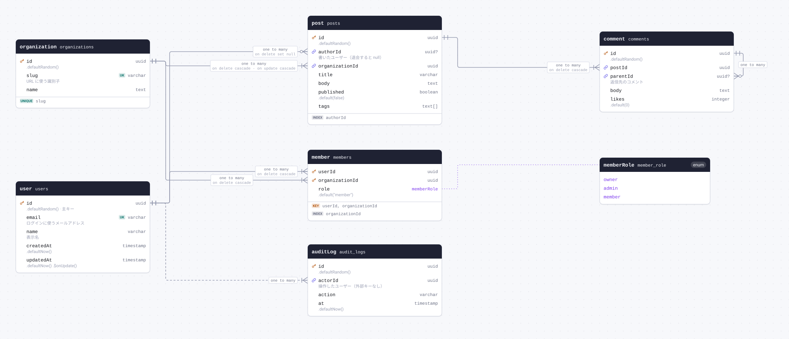
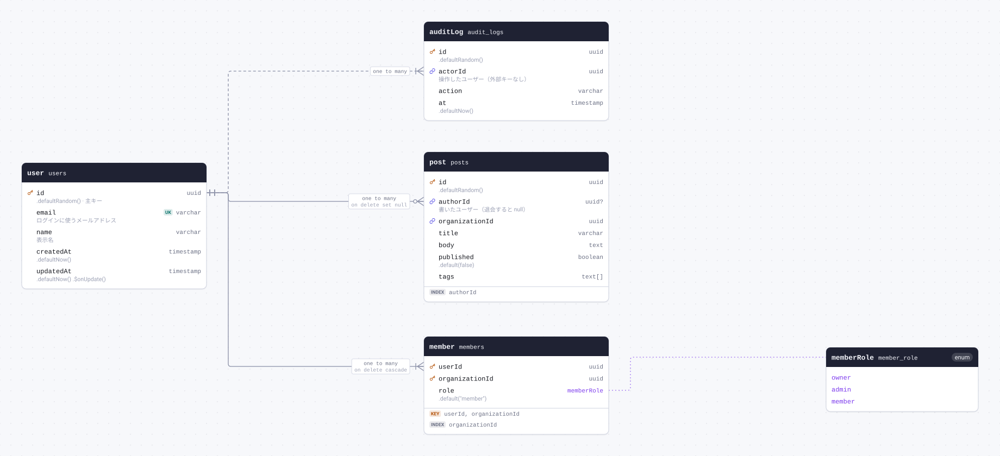
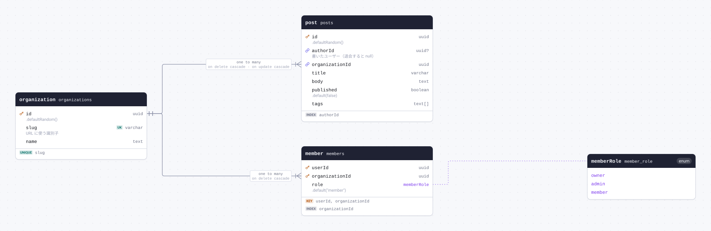
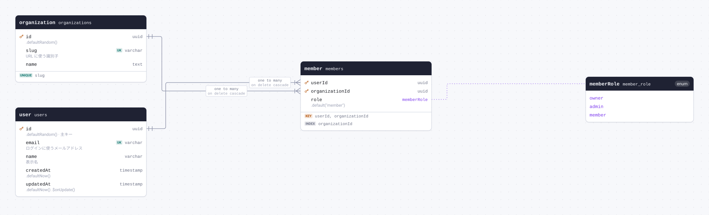
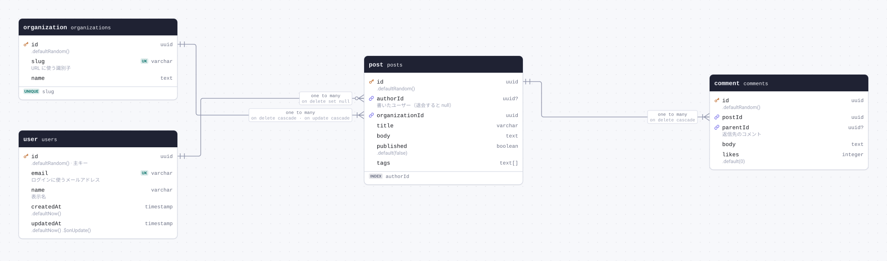
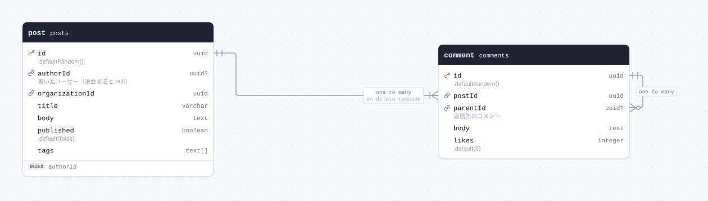
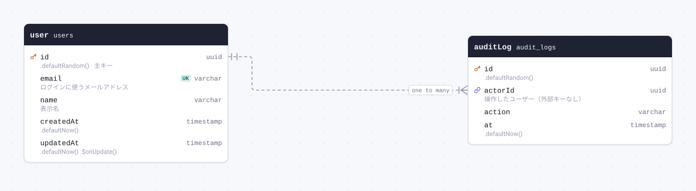

# Schema docs



<details>
<summary>The whole schema as SQL</summary>

```sql
CREATE TYPE "member_role" AS ENUM('owner', 'admin', 'member');

CREATE TABLE "audit_logs" (
	"id" uuid PRIMARY KEY DEFAULT gen_random_uuid(),
	"actor_id" uuid NOT NULL,
	"action" varchar(64) NOT NULL,
	"at" timestamp DEFAULT now() NOT NULL
);

CREATE TABLE "comments" (
	"id" uuid PRIMARY KEY DEFAULT gen_random_uuid(),
	"post_id" uuid NOT NULL,
	"parent_id" uuid,
	"body" text NOT NULL,
	"likes" integer DEFAULT 0 NOT NULL
);

CREATE TABLE "members" (
	"user_id" uuid,
	"organization_id" uuid,
	"role" "member_role" DEFAULT 'member'::"member_role" NOT NULL,
	CONSTRAINT "members_pkey" PRIMARY KEY("user_id","organization_id")
);

CREATE TABLE "organizations" (
	"id" uuid PRIMARY KEY DEFAULT gen_random_uuid(),
	"slug" varchar(64) NOT NULL,
	"name" text NOT NULL
);

CREATE TABLE "posts" (
	"id" uuid PRIMARY KEY DEFAULT gen_random_uuid(),
	"author_id" uuid,
	"organization_id" uuid NOT NULL,
	"title" varchar(200) NOT NULL,
	"body" text NOT NULL,
	"published" boolean DEFAULT false NOT NULL,
	"tags" text[]
);

CREATE TABLE "users" (
	"id" uuid PRIMARY KEY DEFAULT gen_random_uuid(),
	"email" varchar(255) NOT NULL UNIQUE,
	"name" varchar(50) NOT NULL,
	"created_at" timestamp DEFAULT now() NOT NULL,
	"updated_at" timestamp DEFAULT now() NOT NULL
);

CREATE INDEX "members_organization_idx" ON "members" ("organization_id");

CREATE UNIQUE INDEX "organizations_slug_idx" ON "organizations" ("slug");

CREATE INDEX "posts_author_idx" ON "posts" ("author_id");

ALTER TABLE "comments" ADD CONSTRAINT "comments_post_id_posts_id_fkey" FOREIGN KEY ("post_id") REFERENCES "posts"("id") ON DELETE CASCADE;

ALTER TABLE "comments" ADD CONSTRAINT "comments_parent_id_comments_id_fkey" FOREIGN KEY ("parent_id") REFERENCES "comments"("id");

ALTER TABLE "members" ADD CONSTRAINT "members_user_id_users_id_fkey" FOREIGN KEY ("user_id") REFERENCES "users"("id") ON DELETE CASCADE;

ALTER TABLE "members" ADD CONSTRAINT "members_organization_id_organizations_id_fkey" FOREIGN KEY ("organization_id") REFERENCES "organizations"("id") ON DELETE CASCADE;

ALTER TABLE "posts" ADD CONSTRAINT "posts_author_id_users_id_fkey" FOREIGN KEY ("author_id") REFERENCES "users"("id") ON DELETE SET NULL;

ALTER TABLE "posts" ADD CONSTRAINT "posts_organization_id_organizations_id_fkey" FOREIGN KEY ("organization_id") REFERENCES "organizations"("id") ON DELETE CASCADE ON UPDATE CASCADE;
```

</details>

## Contents

| Table                               | Name in the database | Description                                                 |
| ----------------------------------- | -------------------- | ----------------------------------------------------------- |
| [user](#table-user)                 | `users`              | サインインするユーザー                                      |
| [organization](#table-organization) | `organizations`      | ユーザーが所属する組織                                      |
| [member](#table-member)             | `members`            | ユーザーと組織の所属（複合主キー）                          |
| [post](#table-post)                 | `posts`              | 記事                                                        |
| [comment](#table-comment)           | `comments`           | 記事へのコメント（返信は親コメントを指す）                  |
| [auditLog](#table-auditLog)         | `audit_logs`         | 操作の記録。外部キーは張らず、関係は defineRelations で示す |

| Enum                           | Name in the database | Description    |
| ------------------------------ | -------------------- | -------------- |
| [memberRole](#enum-memberRole) | `member_role`        | メンバーの権限 |

## Tables

<a id="table-user"></a>

### user

Table `users`. サインインするユーザー



| Column                     | Type        | Constraints     | Default                        | Description                  |
| -------------------------- | ----------- | --------------- | ------------------------------ | ---------------------------- |
| `id`                       | `uuid`      | PK NOT NULL     | `.defaultRandom()`             | 主キー                       |
| `email`                    | `varchar`   | UNIQUE NOT NULL |                                | ログインに使うメールアドレス |
| `name`                     | `varchar`   | NOT NULL        |                                | 表示名                       |
| `createdAt` (`created_at`) | `timestamp` | NOT NULL        | `.defaultNow()`                |                              |
| `updatedAt` (`updated_at`) | `timestamp` | NOT NULL        | `.defaultNow()` `.$onUpdate()` |                              |

#### Definition

```sql
CREATE TABLE "users" (
	"id" uuid PRIMARY KEY DEFAULT gen_random_uuid(),
	"email" varchar(255) NOT NULL UNIQUE,
	"name" varchar(50) NOT NULL,
	"created_at" timestamp DEFAULT now() NOT NULL,
	"updated_at" timestamp DEFAULT now() NOT NULL
);
```

#### Referenced by

- `id` → [member.userId](#table-member) (one to many, on delete cascade)
- `id` → [post.authorId](#table-post) (one to many, on delete set null)
- `id` → [auditLog.actorId](#table-auditLog) (one to many, defineRelations)

<details>
<summary>Queries and their SQL</summary>

**Select**: Every row of user.

```ts
db.select().from(user);
```

```sql
select "id", "email", "name", "created_at", "updated_at"
from "users"
```

**Count**: How many rows user has.

```ts
db.select({ count: count() }).from(user);
```

```sql
select count(*)
from "users"
```

**Find many with relations**: The rows of user with what they relate to, through the relational query API.

```ts
db.query.user.findMany({ with: { posts: true, memberships: true } });
```

```sql
select "d0"."id" as "id", "d0"."email" as "email", "d0"."name" as "name", "d0"."created_at" as "createdAt", "d0"."updated_at" as "updatedAt", "posts"."r" as "posts", "memberships"."r" as "memberships"
from "users" as "d0"
left join lateral(select coalesce(json_agg(row_to_json("t".*)), '[]') as "r" from (select "d1"."id" as "id", "d1"."author_id" as "authorId", "d1"."organization_id" as "organizationId", "d1"."title" as "title", "d1"."body" as "body", "d1"."published" as "published", "d1"."tags" as "tags" from "posts" as "d1" where "d0"."id" = "d1"."author_id") as "t") as "posts" on true
left join lateral(select coalesce(json_agg(row_to_json("t".*)), '[]') as "r" from (select "d1"."user_id" as "userId", "d1"."organization_id" as "organizationId", "d1"."role" as "role" from "members" as "d1" where "d0"."id" = "d1"."user_id") as "t") as "memberships" on true
```

**Find by primary key**: One row of user, through the relational query API.

```ts
db.query.user.findFirst({ where: { id: "00000000-0000-0000-0000-000000000000" } });
```

```sql
select "d0"."id" as "id", "d0"."email" as "email", "d0"."name" as "name", "d0"."created_at" as "createdAt", "d0"."updated_at" as "updatedAt"
from "users" as "d0"
where "d0"."id" = $1
limit $2
-- params: ["00000000-0000-0000-0000-000000000000",1]
```

**Insert**: Adds a row to user, giving the columns that have no default.

```ts
db.insert(user).values({ email: "email", name: "name" });
```

```sql
insert into "users" ("id", "email", "name", "created_at", "updated_at")
values (default, $1, $2, default, default)
-- params: ["email","name"]
```

**Update**: Changes a row of user, found by its primary key.

```ts
db.update(user).set({ email: "email" }).where(eq(user.id, "00000000-0000-0000-0000-000000000000"));
```

```sql
update "users"
set "email" = $1, "updated_at" = $2
where "users"."id" = $3
-- params: ["email","2026-01-01T00:00:00.000Z","00000000-0000-0000-0000-000000000000"]
```

**Delete**: Deletes a row of user, found by its primary key.

```ts
db.delete(user).where(eq(user.id, "00000000-0000-0000-0000-000000000000"));
```

```sql
delete from "users"
where "users"."id" = $1
-- params: ["00000000-0000-0000-0000-000000000000"]
```

</details>

<a id="table-organization"></a>

### organization

Table `organizations`. ユーザーが所属する組織



| Column | Type      | Constraints | Default            | Description      |
| ------ | --------- | ----------- | ------------------ | ---------------- |
| `id`   | `uuid`    | PK NOT NULL | `.defaultRandom()` |                  |
| `slug` | `varchar` | NOT NULL    |                    | URL に使う識別子 |
| `name` | `text`    | NOT NULL    |                    |                  |

#### Definition

```sql
CREATE TABLE "organizations" (
	"id" uuid PRIMARY KEY DEFAULT gen_random_uuid(),
	"slug" varchar(64) NOT NULL,
	"name" text NOT NULL
);

CREATE UNIQUE INDEX "organizations_slug_idx" ON "organizations" ("slug");
```

#### Indexes

- UNIQUE `slug`

#### Referenced by

- `id` → [member.organizationId](#table-member) (one to many, on delete cascade)
- `id` → [post.organizationId](#table-post) (one to many, on delete cascade, on update cascade)

<details>
<summary>Queries and their SQL</summary>

**Select**: Every row of organization.

```ts
db.select().from(organization);
```

```sql
select "id", "slug", "name"
from "organizations"
```

**Count**: How many rows organization has.

```ts
db.select({ count: count() }).from(organization);
```

```sql
select count(*)
from "organizations"
```

**Find many**: The rows of organization, through the relational query API.

```ts
db.query.organization.findMany();
```

```sql
select "d0"."id" as "id", "d0"."slug" as "slug", "d0"."name" as "name"
from "organizations" as "d0"
```

**Find by primary key**: One row of organization, through the relational query API.

```ts
db.query.organization.findFirst({ where: { id: "00000000-0000-0000-0000-000000000000" } });
```

```sql
select "d0"."id" as "id", "d0"."slug" as "slug", "d0"."name" as "name"
from "organizations" as "d0"
where "d0"."id" = $1
limit $2
-- params: ["00000000-0000-0000-0000-000000000000",1]
```

**Insert**: Adds a row to organization, giving the columns that have no default.

```ts
db.insert(organization).values({ slug: "slug", name: "name" });
```

```sql
insert into "organizations" ("id", "slug", "name")
values (default, $1, $2)
-- params: ["slug","name"]
```

**Update**: Changes a row of organization, found by its primary key.

```ts
db.update(organization)
  .set({ slug: "slug" })
  .where(eq(organization.id, "00000000-0000-0000-0000-000000000000"));
```

```sql
update "organizations"
set "slug" = $1
where "organizations"."id" = $2
-- params: ["slug","00000000-0000-0000-0000-000000000000"]
```

**Delete**: Deletes a row of organization, found by its primary key.

```ts
db.delete(organization).where(eq(organization.id, "00000000-0000-0000-0000-000000000000"));
```

```sql
delete from "organizations"
where "organizations"."id" = $1
-- params: ["00000000-0000-0000-0000-000000000000"]
```

</details>

<a id="table-member"></a>

### member

Table `members`. ユーザーと組織の所属（複合主キー）



| Column                               | Type                             | Constraints                                          | Default              | Description |
| ------------------------------------ | -------------------------------- | ---------------------------------------------------- | -------------------- | ----------- |
| `userId` (`user_id`)                 | `uuid`                           | PK NOT NULL → [user.id](#table-user)                 |                      |             |
| `organizationId` (`organization_id`) | `uuid`                           | PK NOT NULL → [organization.id](#table-organization) |                      |             |
| `role`                               | [`memberRole`](#enum-memberRole) | NOT NULL                                             | `.default("member")` |             |

#### Definition

```sql
CREATE TABLE "members" (
	"user_id" uuid,
	"organization_id" uuid,
	"role" "member_role" DEFAULT 'member'::"member_role" NOT NULL,
	CONSTRAINT "members_pkey" PRIMARY KEY("user_id","organization_id")
);

CREATE INDEX "members_organization_idx" ON "members" ("organization_id");

ALTER TABLE "members" ADD CONSTRAINT "members_user_id_users_id_fkey" FOREIGN KEY ("user_id") REFERENCES "users"("id") ON DELETE CASCADE;

ALTER TABLE "members" ADD CONSTRAINT "members_organization_id_organizations_id_fkey" FOREIGN KEY ("organization_id") REFERENCES "organizations"("id") ON DELETE CASCADE;
```

#### Indexes

- PRIMARY KEY `userId`, `organizationId`
- INDEX `organizationId`

#### References

- `userId` → [user.id](#table-user) (many to one, on delete cascade)
- `organizationId` → [organization.id](#table-organization) (many to one, on delete cascade)

<details>
<summary>Queries and their SQL</summary>

**Select**: Every row of member.

```ts
db.select().from(member);
```

```sql
select "user_id", "organization_id", "role"
from "members"
```

**Count**: How many rows member has.

```ts
db.select({ count: count() }).from(member);
```

```sql
select count(*)
from "members"
```

**Find many with relations**: The rows of member with what they relate to, through the relational query API.

```ts
db.query.member.findMany({ with: { user: true } });
```

```sql
select "d0"."user_id" as "userId", "d0"."organization_id" as "organizationId", "d0"."role" as "role", "user"."r" as "user"
from "members" as "d0"
left join lateral(select row_to_json("t".*) "r" from (select "d1"."id" as "id", "d1"."email" as "email", "d1"."name" as "name", "d1"."created_at" as "createdAt", "d1"."updated_at" as "updatedAt" from "users" as "d1" where "d0"."user_id" = "d1"."id" limit $1) as "t") as "user" on true
-- params: [1]
```

**Find by primary key**: One row of member, through the relational query API.

```ts
db.query.member.findFirst({
  where: {
    userId: "00000000-0000-0000-0000-000000000000",
    organizationId: "00000000-0000-0000-0000-000000000000",
  },
});
```

```sql
select "d0"."user_id" as "userId", "d0"."organization_id" as "organizationId", "d0"."role" as "role"
from "members" as "d0"
where (("d0"."user_id" = $1) and ("d0"."organization_id" = $2))
limit $3
-- params: ["00000000-0000-0000-0000-000000000000","00000000-0000-0000-0000-000000000000",1]
```

**Insert**: Adds a row to member, giving the columns that have no default.

```ts
db.insert(member).values({
  userId: "00000000-0000-0000-0000-000000000000",
  organizationId: "00000000-0000-0000-0000-000000000000",
});
```

```sql
insert into "members" ("user_id", "organization_id", "role")
values ($1, $2, default)
-- params: ["00000000-0000-0000-0000-000000000000","00000000-0000-0000-0000-000000000000"]
```

**Update**: Changes a row of member, found by its primary key.

```ts
db.update(member)
  .set({ role: "owner" })
  .where(
    and(
      eq(member.userId, "00000000-0000-0000-0000-000000000000"),
      eq(member.organizationId, "00000000-0000-0000-0000-000000000000"),
    ),
  );
```

```sql
update "members"
set "role" = $1
where (("members"."user_id" = $2) and ("members"."organization_id" = $3))
-- params: ["owner","00000000-0000-0000-0000-000000000000","00000000-0000-0000-0000-000000000000"]
```

**Delete**: Deletes a row of member, found by its primary key.

```ts
db.delete(member).where(
  and(
    eq(member.userId, "00000000-0000-0000-0000-000000000000"),
    eq(member.organizationId, "00000000-0000-0000-0000-000000000000"),
  ),
);
```

```sql
delete from "members"
where (("members"."user_id" = $1) and ("members"."organization_id" = $2))
-- params: ["00000000-0000-0000-0000-000000000000","00000000-0000-0000-0000-000000000000"]
```

</details>

<a id="table-post"></a>

### post

Table `posts`. 記事



| Column                               | Type      | Constraints                                       | Default            | Description                       |
| ------------------------------------ | --------- | ------------------------------------------------- | ------------------ | --------------------------------- |
| `id`                                 | `uuid`    | PK NOT NULL                                       | `.defaultRandom()` |                                   |
| `authorId` (`author_id`)             | `uuid`    | NULL → [user.id](#table-user)                     |                    | 書いたユーザー（退会すると null） |
| `organizationId` (`organization_id`) | `uuid`    | NOT NULL → [organization.id](#table-organization) |                    |                                   |
| `title`                              | `varchar` | NOT NULL                                          |                    |                                   |
| `body`                               | `text`    | NOT NULL                                          |                    |                                   |
| `published`                          | `boolean` | NOT NULL                                          | `.default(false)`  |                                   |
| `tags`                               | `text[]`  | NULL                                              |                    |                                   |

#### Definition

```sql
CREATE TABLE "posts" (
	"id" uuid PRIMARY KEY DEFAULT gen_random_uuid(),
	"author_id" uuid,
	"organization_id" uuid NOT NULL,
	"title" varchar(200) NOT NULL,
	"body" text NOT NULL,
	"published" boolean DEFAULT false NOT NULL,
	"tags" text[]
);

CREATE INDEX "posts_author_idx" ON "posts" ("author_id");

ALTER TABLE "posts" ADD CONSTRAINT "posts_author_id_users_id_fkey" FOREIGN KEY ("author_id") REFERENCES "users"("id") ON DELETE SET NULL;

ALTER TABLE "posts" ADD CONSTRAINT "posts_organization_id_organizations_id_fkey" FOREIGN KEY ("organization_id") REFERENCES "organizations"("id") ON DELETE CASCADE ON UPDATE CASCADE;
```

#### Indexes

- INDEX `authorId`

#### References

- `authorId` → [user.id](#table-user) (many to one, on delete set null)
- `organizationId` → [organization.id](#table-organization) (many to one, on delete cascade, on update cascade)

#### Referenced by

- `id` → [comment.postId](#table-comment) (one to many, on delete cascade)

<details>
<summary>Queries and their SQL</summary>

**Select**: Every row of post.

```ts
db.select().from(post);
```

```sql
select "id", "author_id", "organization_id", "title", "body", "published", "tags"
from "posts"
```

**Count**: How many rows post has.

```ts
db.select({ count: count() }).from(post);
```

```sql
select count(*)
from "posts"
```

**Find many with relations**: The rows of post with what they relate to, through the relational query API.

```ts
db.query.post.findMany({ with: { author: true, comments: true } });
```

```sql
select "d0"."id" as "id", "d0"."author_id" as "authorId", "d0"."organization_id" as "organizationId", "d0"."title" as "title", "d0"."body" as "body", "d0"."published" as "published", "d0"."tags" as "tags", "author"."r" as "author", "comments"."r" as "comments"
from "posts" as "d0"
left join lateral(select row_to_json("t".*) "r" from (select "d1"."id" as "id", "d1"."email" as "email", "d1"."name" as "name", "d1"."created_at" as "createdAt", "d1"."updated_at" as "updatedAt" from "users" as "d1" where "d0"."author_id" = "d1"."id" limit $1) as "t") as "author" on true
left join lateral(select coalesce(json_agg(row_to_json("t".*)), '[]') as "r" from (select "d1"."id" as "id", "d1"."post_id" as "postId", "d1"."parent_id" as "parentId", "d1"."body" as "body", "d1"."likes" as "likes" from "comments" as "d1" where "d0"."id" = "d1"."post_id") as "t") as "comments" on true
-- params: [1]
```

**Find by primary key**: One row of post, through the relational query API.

```ts
db.query.post.findFirst({ where: { id: "00000000-0000-0000-0000-000000000000" } });
```

```sql
select "d0"."id" as "id", "d0"."author_id" as "authorId", "d0"."organization_id" as "organizationId", "d0"."title" as "title", "d0"."body" as "body", "d0"."published" as "published", "d0"."tags" as "tags"
from "posts" as "d0"
where "d0"."id" = $1
limit $2
-- params: ["00000000-0000-0000-0000-000000000000",1]
```

**Insert**: Adds a row to post, giving the columns that have no default.

```ts
db.insert(post).values({
  organizationId: "00000000-0000-0000-0000-000000000000",
  title: "title",
  body: "body",
});
```

```sql
insert into "posts" ("id", "author_id", "organization_id", "title", "body", "published", "tags")
values (default, default, $1, $2, $3, default, default)
-- params: ["00000000-0000-0000-0000-000000000000","title","body"]
```

**Update**: Changes a row of post, found by its primary key.

```ts
db.update(post)
  .set({ authorId: "00000000-0000-0000-0000-000000000000" })
  .where(eq(post.id, "00000000-0000-0000-0000-000000000000"));
```

```sql
update "posts"
set "author_id" = $1
where "posts"."id" = $2
-- params: ["00000000-0000-0000-0000-000000000000","00000000-0000-0000-0000-000000000000"]
```

**Delete**: Deletes a row of post, found by its primary key.

```ts
db.delete(post).where(eq(post.id, "00000000-0000-0000-0000-000000000000"));
```

```sql
delete from "posts"
where "posts"."id" = $1
-- params: ["00000000-0000-0000-0000-000000000000"]
```

</details>

<a id="table-comment"></a>

### comment

Table `comments`. 記事へのコメント（返信は親コメントを指す）



| Column                   | Type      | Constraints                         | Default            | Description      |
| ------------------------ | --------- | ----------------------------------- | ------------------ | ---------------- |
| `id`                     | `uuid`    | PK NOT NULL                         | `.defaultRandom()` |                  |
| `postId` (`post_id`)     | `uuid`    | NOT NULL → [post.id](#table-post)   |                    |                  |
| `parentId` (`parent_id`) | `uuid`    | NULL → [comment.id](#table-comment) |                    | 返信先のコメント |
| `body`                   | `text`    | NOT NULL                            |                    |                  |
| `likes`                  | `integer` | NOT NULL                            | `.default(0)`      |                  |

#### Definition

```sql
CREATE TABLE "comments" (
	"id" uuid PRIMARY KEY DEFAULT gen_random_uuid(),
	"post_id" uuid NOT NULL,
	"parent_id" uuid,
	"body" text NOT NULL,
	"likes" integer DEFAULT 0 NOT NULL
);

ALTER TABLE "comments" ADD CONSTRAINT "comments_post_id_posts_id_fkey" FOREIGN KEY ("post_id") REFERENCES "posts"("id") ON DELETE CASCADE;

ALTER TABLE "comments" ADD CONSTRAINT "comments_parent_id_comments_id_fkey" FOREIGN KEY ("parent_id") REFERENCES "comments"("id");
```

#### References

- `postId` → [post.id](#table-post) (many to one, on delete cascade)
- `parentId` → [comment.id](#table-comment) (many to one)

#### Referenced by

- `id` → [comment.parentId](#table-comment) (one to many)

<details>
<summary>Queries and their SQL</summary>

**Select**: Every row of comment.

```ts
db.select().from(comment);
```

```sql
select "id", "post_id", "parent_id", "body", "likes"
from "comments"
```

**Count**: How many rows comment has.

```ts
db.select({ count: count() }).from(comment);
```

```sql
select count(*)
from "comments"
```

**Find many with relations**: The rows of comment with what they relate to, through the relational query API.

```ts
db.query.comment.findMany({ with: { post: true } });
```

```sql
select "d0"."id" as "id", "d0"."post_id" as "postId", "d0"."parent_id" as "parentId", "d0"."body" as "body", "d0"."likes" as "likes", "post"."r" as "post"
from "comments" as "d0"
left join lateral(select row_to_json("t".*) "r" from (select "d1"."id" as "id", "d1"."author_id" as "authorId", "d1"."organization_id" as "organizationId", "d1"."title" as "title", "d1"."body" as "body", "d1"."published" as "published", "d1"."tags" as "tags" from "posts" as "d1" where "d0"."post_id" = "d1"."id" limit $1) as "t") as "post" on true
-- params: [1]
```

**Find by primary key**: One row of comment, through the relational query API.

```ts
db.query.comment.findFirst({ where: { id: "00000000-0000-0000-0000-000000000000" } });
```

```sql
select "d0"."id" as "id", "d0"."post_id" as "postId", "d0"."parent_id" as "parentId", "d0"."body" as "body", "d0"."likes" as "likes"
from "comments" as "d0"
where "d0"."id" = $1
limit $2
-- params: ["00000000-0000-0000-0000-000000000000",1]
```

**Insert**: Adds a row to comment, giving the columns that have no default.

```ts
db.insert(comment).values({ postId: "00000000-0000-0000-0000-000000000000", body: "body" });
```

```sql
insert into "comments" ("id", "post_id", "parent_id", "body", "likes")
values (default, $1, default, $2, default)
-- params: ["00000000-0000-0000-0000-000000000000","body"]
```

**Update**: Changes a row of comment, found by its primary key.

```ts
db.update(comment)
  .set({ postId: "00000000-0000-0000-0000-000000000000" })
  .where(eq(comment.id, "00000000-0000-0000-0000-000000000000"));
```

```sql
update "comments"
set "post_id" = $1
where "comments"."id" = $2
-- params: ["00000000-0000-0000-0000-000000000000","00000000-0000-0000-0000-000000000000"]
```

**Delete**: Deletes a row of comment, found by its primary key.

```ts
db.delete(comment).where(eq(comment.id, "00000000-0000-0000-0000-000000000000"));
```

```sql
delete from "comments"
where "comments"."id" = $1
-- params: ["00000000-0000-0000-0000-000000000000"]
```

</details>

<a id="table-auditLog"></a>

### auditLog

Table `audit_logs`. 操作の記録。外部キーは張らず、関係は defineRelations で示す



| Column                 | Type        | Constraints                       | Default            | Description                      |
| ---------------------- | ----------- | --------------------------------- | ------------------ | -------------------------------- |
| `id`                   | `uuid`      | PK NOT NULL                       | `.defaultRandom()` |                                  |
| `actorId` (`actor_id`) | `uuid`      | NOT NULL → [user.id](#table-user) |                    | 操作したユーザー（外部キーなし） |
| `action`               | `varchar`   | NOT NULL                          |                    |                                  |
| `at`                   | `timestamp` | NOT NULL                          | `.defaultNow()`    |                                  |

#### Definition

```sql
CREATE TABLE "audit_logs" (
	"id" uuid PRIMARY KEY DEFAULT gen_random_uuid(),
	"actor_id" uuid NOT NULL,
	"action" varchar(64) NOT NULL,
	"at" timestamp DEFAULT now() NOT NULL
);
```

#### References

- `actorId` → [user.id](#table-user) (many to one, defineRelations, no foreign key)

<details>
<summary>Queries and their SQL</summary>

**Select**: Every row of auditLog.

```ts
db.select().from(auditLog);
```

```sql
select "id", "actor_id", "action", "at"
from "audit_logs"
```

**Count**: How many rows auditLog has.

```ts
db.select({ count: count() }).from(auditLog);
```

```sql
select count(*)
from "audit_logs"
```

**Find many with relations**: The rows of auditLog with what they relate to, through the relational query API.

```ts
db.query.auditLog.findMany({ with: { actor: true } });
```

```sql
select "d0"."id" as "id", "d0"."actor_id" as "actorId", "d0"."action" as "action", "d0"."at" as "at", "actor"."r" as "actor"
from "audit_logs" as "d0"
left join lateral(select row_to_json("t".*) "r" from (select "d1"."id" as "id", "d1"."email" as "email", "d1"."name" as "name", "d1"."created_at" as "createdAt", "d1"."updated_at" as "updatedAt" from "users" as "d1" where "d0"."actor_id" = "d1"."id" limit $1) as "t") as "actor" on true
-- params: [1]
```

**Find by primary key**: One row of auditLog, through the relational query API.

```ts
db.query.auditLog.findFirst({ where: { id: "00000000-0000-0000-0000-000000000000" } });
```

```sql
select "d0"."id" as "id", "d0"."actor_id" as "actorId", "d0"."action" as "action", "d0"."at" as "at"
from "audit_logs" as "d0"
where "d0"."id" = $1
limit $2
-- params: ["00000000-0000-0000-0000-000000000000",1]
```

**Insert**: Adds a row to auditLog, giving the columns that have no default.

```ts
db.insert(auditLog).values({ actorId: "00000000-0000-0000-0000-000000000000", action: "action" });
```

```sql
insert into "audit_logs" ("id", "actor_id", "action", "at")
values (default, $1, $2, default)
-- params: ["00000000-0000-0000-0000-000000000000","action"]
```

**Update**: Changes a row of auditLog, found by its primary key.

```ts
db.update(auditLog)
  .set({ actorId: "00000000-0000-0000-0000-000000000000" })
  .where(eq(auditLog.id, "00000000-0000-0000-0000-000000000000"));
```

```sql
update "audit_logs"
set "actor_id" = $1
where "audit_logs"."id" = $2
-- params: ["00000000-0000-0000-0000-000000000000","00000000-0000-0000-0000-000000000000"]
```

**Delete**: Deletes a row of auditLog, found by its primary key.

```ts
db.delete(auditLog).where(eq(auditLog.id, "00000000-0000-0000-0000-000000000000"));
```

```sql
delete from "audit_logs"
where "audit_logs"."id" = $1
-- params: ["00000000-0000-0000-0000-000000000000"]
```

</details>

## Enums

<a id="enum-memberRole"></a>

### memberRole

Type `member_role`. メンバーの権限

- `owner`
- `admin`
- `member`

#### Definition

```sql
CREATE TYPE "member_role" AS ENUM('owner', 'admin', 'member');
```
