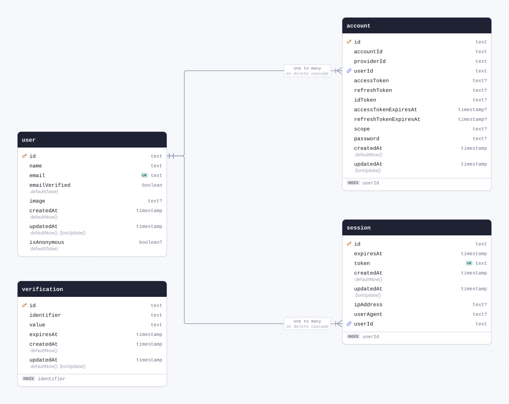
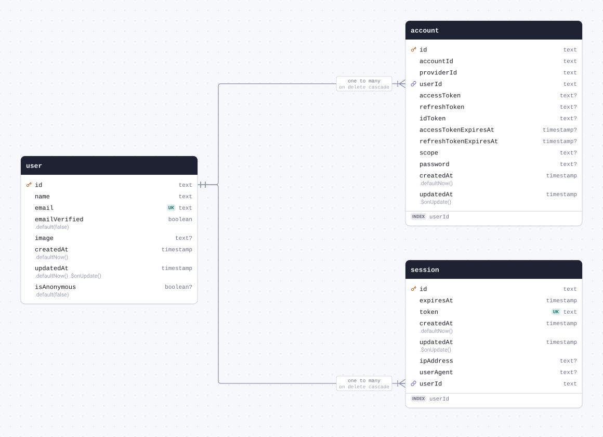
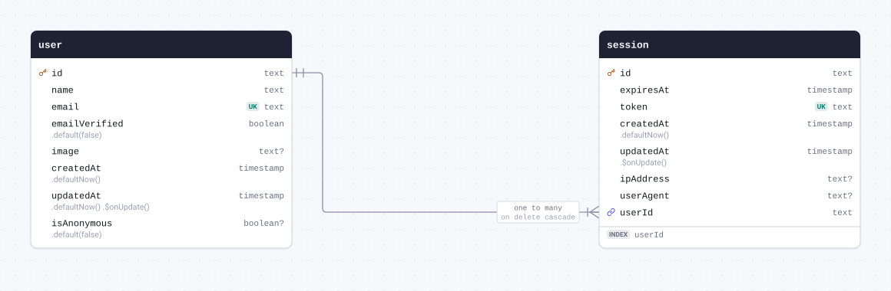
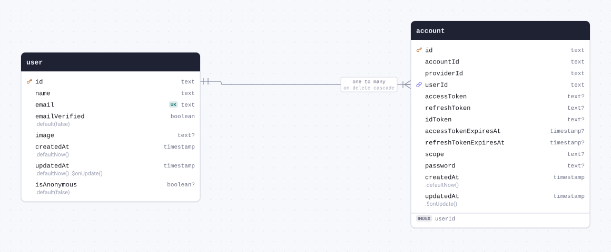

# Schema docs



<details>
<summary>The whole schema as SQL</summary>

```sql
CREATE TABLE "account" (
	"id" text PRIMARY KEY,
	"account_id" text NOT NULL,
	"provider_id" text NOT NULL,
	"user_id" text NOT NULL,
	"access_token" text,
	"refresh_token" text,
	"id_token" text,
	"access_token_expires_at" timestamp,
	"refresh_token_expires_at" timestamp,
	"scope" text,
	"password" text,
	"created_at" timestamp DEFAULT now() NOT NULL,
	"updated_at" timestamp NOT NULL
);

CREATE TABLE "session" (
	"id" text PRIMARY KEY,
	"expires_at" timestamp NOT NULL,
	"token" text NOT NULL UNIQUE,
	"created_at" timestamp DEFAULT now() NOT NULL,
	"updated_at" timestamp NOT NULL,
	"ip_address" text,
	"user_agent" text,
	"user_id" text NOT NULL
);

CREATE TABLE "user" (
	"id" text PRIMARY KEY,
	"name" text NOT NULL,
	"email" text NOT NULL UNIQUE,
	"email_verified" boolean DEFAULT false NOT NULL,
	"image" text,
	"created_at" timestamp DEFAULT now() NOT NULL,
	"updated_at" timestamp DEFAULT now() NOT NULL,
	"is_anonymous" boolean DEFAULT false
);

CREATE TABLE "verification" (
	"id" text PRIMARY KEY,
	"identifier" text NOT NULL,
	"value" text NOT NULL,
	"expires_at" timestamp NOT NULL,
	"created_at" timestamp DEFAULT now() NOT NULL,
	"updated_at" timestamp DEFAULT now() NOT NULL
);

CREATE INDEX "account_userId_idx" ON "account" ("user_id");

CREATE INDEX "session_userId_idx" ON "session" ("user_id");

CREATE INDEX "verification_identifier_idx" ON "verification" ("identifier");

ALTER TABLE "account" ADD CONSTRAINT "account_user_id_user_id_fkey" FOREIGN KEY ("user_id") REFERENCES "user"("id") ON DELETE CASCADE;

ALTER TABLE "session" ADD CONSTRAINT "session_user_id_user_id_fkey" FOREIGN KEY ("user_id") REFERENCES "user"("id") ON DELETE CASCADE;
```

</details>

## Contents

| Table                               | Name in the database | Description |
| ----------------------------------- | -------------------- | ----------- |
| [user](#table-user)                 | `user`               |             |
| [session](#table-session)           | `session`            |             |
| [account](#table-account)           | `account`            |             |
| [verification](#table-verification) | `verification`       |             |

## Tables

<a id="table-user"></a>

### user



| Column                             | Type        | Constraints     | Default                        | Description |
| ---------------------------------- | ----------- | --------------- | ------------------------------ | ----------- |
| `id`                               | `text`      | PK NOT NULL     |                                |             |
| `name`                             | `text`      | NOT NULL        |                                |             |
| `email`                            | `text`      | UNIQUE NOT NULL |                                |             |
| `emailVerified` (`email_verified`) | `boolean`   | NOT NULL        | `.default(false)`              |             |
| `image`                            | `text`      | NULL            |                                |             |
| `createdAt` (`created_at`)         | `timestamp` | NOT NULL        | `.defaultNow()`                |             |
| `updatedAt` (`updated_at`)         | `timestamp` | NOT NULL        | `.defaultNow()` `.$onUpdate()` |             |
| `isAnonymous` (`is_anonymous`)     | `boolean`   | NULL            | `.default(false)`              |             |

#### Definition

```sql
CREATE TABLE "user" (
	"id" text PRIMARY KEY,
	"name" text NOT NULL,
	"email" text NOT NULL UNIQUE,
	"email_verified" boolean DEFAULT false NOT NULL,
	"image" text,
	"created_at" timestamp DEFAULT now() NOT NULL,
	"updated_at" timestamp DEFAULT now() NOT NULL,
	"is_anonymous" boolean DEFAULT false
);
```

#### Referenced by

- `id` → [session.userId](#table-session) (one to many, on delete cascade)
- `id` → [account.userId](#table-account) (one to many, on delete cascade)

<details>
<summary>Queries and their SQL</summary>

**Select**: Every row of user.

```ts
db.select().from(user);
```

```sql
select "id", "name", "email", "email_verified", "image", "created_at", "updated_at", "is_anonymous"
from "user"
```

**Count**: How many rows user has.

```ts
db.select({ count: count() }).from(user);
```

```sql
select count(*)
from "user"
```

**Find many with relations**: The rows of user with what they relate to, through the relational query API.

```ts
db.query.user.findMany({ with: { sessions: true, accounts: true } });
```

```sql
select "d0"."id" as "id", "d0"."name" as "name", "d0"."email" as "email", "d0"."email_verified" as "emailVerified", "d0"."image" as "image", "d0"."created_at" as "createdAt", "d0"."updated_at" as "updatedAt", "d0"."is_anonymous" as "isAnonymous", "sessions"."r" as "sessions", "accounts"."r" as "accounts"
from "user" as "d0"
left join lateral(select coalesce(json_agg(row_to_json("t".*)), '[]') as "r" from (select "d1"."id" as "id", "d1"."expires_at" as "expiresAt", "d1"."token" as "token", "d1"."created_at" as "createdAt", "d1"."updated_at" as "updatedAt", "d1"."ip_address" as "ipAddress", "d1"."user_agent" as "userAgent", "d1"."user_id" as "userId" from "session" as "d1" where "d0"."id" = "d1"."user_id") as "t") as "sessions" on true
left join lateral(select coalesce(json_agg(row_to_json("t".*)), '[]') as "r" from (select "d1"."id" as "id", "d1"."account_id" as "accountId", "d1"."provider_id" as "providerId", "d1"."user_id" as "userId", "d1"."access_token" as "accessToken", "d1"."refresh_token" as "refreshToken", "d1"."id_token" as "idToken", "d1"."access_token_expires_at" as "accessTokenExpiresAt", "d1"."refresh_token_expires_at" as "refreshTokenExpiresAt", "d1"."scope" as "scope", "d1"."password" as "password", "d1"."created_at" as "createdAt", "d1"."updated_at" as "updatedAt" from "account" as "d1" where "d0"."id" = "d1"."user_id") as "t") as "accounts" on true
```

**Find by primary key**: One row of user, through the relational query API.

```ts
db.query.user.findFirst({ where: { id: "id" } });
```

```sql
select "d0"."id" as "id", "d0"."name" as "name", "d0"."email" as "email", "d0"."email_verified" as "emailVerified", "d0"."image" as "image", "d0"."created_at" as "createdAt", "d0"."updated_at" as "updatedAt", "d0"."is_anonymous" as "isAnonymous"
from "user" as "d0"
where "d0"."id" = $1
limit $2
-- params: ["id",1]
```

**Insert**: Adds a row to user, giving the columns that have no default.

```ts
db.insert(user).values({ id: "id", name: "name", email: "email" });
```

```sql
insert into "user" ("id", "name", "email", "email_verified", "image", "created_at", "updated_at", "is_anonymous")
values ($1, $2, $3, default, default, default, default, default)
-- params: ["id","name","email"]
```

**Update**: Changes a row of user, found by its primary key.

```ts
db.update(user).set({ name: "name" }).where(eq(user.id, "id"));
```

```sql
update "user"
set "name" = $1, "updated_at" = $2
where "user"."id" = $3
-- params: ["name","2026-01-01T00:00:00.000Z","id"]
```

**Delete**: Deletes a row of user, found by its primary key.

```ts
db.delete(user).where(eq(user.id, "id"));
```

```sql
delete from "user"
where "user"."id" = $1
-- params: ["id"]
```

</details>

<a id="table-session"></a>

### session



| Column                     | Type        | Constraints                       | Default         | Description |
| -------------------------- | ----------- | --------------------------------- | --------------- | ----------- |
| `id`                       | `text`      | PK NOT NULL                       |                 |             |
| `expiresAt` (`expires_at`) | `timestamp` | NOT NULL                          |                 |             |
| `token`                    | `text`      | UNIQUE NOT NULL                   |                 |             |
| `createdAt` (`created_at`) | `timestamp` | NOT NULL                          | `.defaultNow()` |             |
| `updatedAt` (`updated_at`) | `timestamp` | NOT NULL                          | `.$onUpdate()`  |             |
| `ipAddress` (`ip_address`) | `text`      | NULL                              |                 |             |
| `userAgent` (`user_agent`) | `text`      | NULL                              |                 |             |
| `userId` (`user_id`)       | `text`      | NOT NULL → [user.id](#table-user) |                 |             |

#### Definition

```sql
CREATE TABLE "session" (
	"id" text PRIMARY KEY,
	"expires_at" timestamp NOT NULL,
	"token" text NOT NULL UNIQUE,
	"created_at" timestamp DEFAULT now() NOT NULL,
	"updated_at" timestamp NOT NULL,
	"ip_address" text,
	"user_agent" text,
	"user_id" text NOT NULL
);

CREATE INDEX "session_userId_idx" ON "session" ("user_id");

ALTER TABLE "session" ADD CONSTRAINT "session_user_id_user_id_fkey" FOREIGN KEY ("user_id") REFERENCES "user"("id") ON DELETE CASCADE;
```

#### Indexes

- INDEX `userId`

#### References

- `userId` → [user.id](#table-user) (many to one, on delete cascade)

<details>
<summary>Queries and their SQL</summary>

**Select**: Every row of session.

```ts
db.select().from(session);
```

```sql
select "id", "expires_at", "token", "created_at", "updated_at", "ip_address", "user_agent", "user_id"
from "session"
```

**Count**: How many rows session has.

```ts
db.select({ count: count() }).from(session);
```

```sql
select count(*)
from "session"
```

**Find many with relations**: The rows of session with what they relate to, through the relational query API.

```ts
db.query.session.findMany({ with: { user: true } });
```

```sql
select "d0"."id" as "id", "d0"."expires_at" as "expiresAt", "d0"."token" as "token", "d0"."created_at" as "createdAt", "d0"."updated_at" as "updatedAt", "d0"."ip_address" as "ipAddress", "d0"."user_agent" as "userAgent", "d0"."user_id" as "userId", "user"."r" as "user"
from "session" as "d0"
left join lateral(select row_to_json("t".*) "r" from (select "d1"."id" as "id", "d1"."name" as "name", "d1"."email" as "email", "d1"."email_verified" as "emailVerified", "d1"."image" as "image", "d1"."created_at" as "createdAt", "d1"."updated_at" as "updatedAt", "d1"."is_anonymous" as "isAnonymous" from "user" as "d1" where "d0"."user_id" = "d1"."id" limit $1) as "t") as "user" on true
-- params: [1]
```

**Find by primary key**: One row of session, through the relational query API.

```ts
db.query.session.findFirst({ where: { id: "id" } });
```

```sql
select "d0"."id" as "id", "d0"."expires_at" as "expiresAt", "d0"."token" as "token", "d0"."created_at" as "createdAt", "d0"."updated_at" as "updatedAt", "d0"."ip_address" as "ipAddress", "d0"."user_agent" as "userAgent", "d0"."user_id" as "userId"
from "session" as "d0"
where "d0"."id" = $1
limit $2
-- params: ["id",1]
```

**Insert**: Adds a row to session, giving the columns that have no default.

```ts
db.insert(session).values({
  id: "id",
  expiresAt: new Date("2026-01-01T00:00:00.000Z"),
  token: "token",
  updatedAt: new Date("2026-01-01T00:00:00.000Z"),
  userId: "userId",
});
```

```sql
insert into "session" ("id", "expires_at", "token", "created_at", "updated_at", "ip_address", "user_agent", "user_id")
values ($1, $2, $3, default, $4, default, default, $5)
-- params: ["id","2026-01-01T00:00:00.000Z","token","2026-01-01T00:00:00.000Z","userId"]
```

**Update**: Changes a row of session, found by its primary key.

```ts
db.update(session)
  .set({ expiresAt: new Date("2026-01-01T00:00:00.000Z") })
  .where(eq(session.id, "id"));
```

```sql
update "session"
set "expires_at" = $1, "updated_at" = $2
where "session"."id" = $3
-- params: ["2026-01-01T00:00:00.000Z","2026-01-01T00:00:00.000Z","id"]
```

**Delete**: Deletes a row of session, found by its primary key.

```ts
db.delete(session).where(eq(session.id, "id"));
```

```sql
delete from "session"
where "session"."id" = $1
-- params: ["id"]
```

</details>

<a id="table-account"></a>

### account



| Column                                               | Type        | Constraints                       | Default         | Description |
| ---------------------------------------------------- | ----------- | --------------------------------- | --------------- | ----------- |
| `id`                                                 | `text`      | PK NOT NULL                       |                 |             |
| `accountId` (`account_id`)                           | `text`      | NOT NULL                          |                 |             |
| `providerId` (`provider_id`)                         | `text`      | NOT NULL                          |                 |             |
| `userId` (`user_id`)                                 | `text`      | NOT NULL → [user.id](#table-user) |                 |             |
| `accessToken` (`access_token`)                       | `text`      | NULL                              |                 |             |
| `refreshToken` (`refresh_token`)                     | `text`      | NULL                              |                 |             |
| `idToken` (`id_token`)                               | `text`      | NULL                              |                 |             |
| `accessTokenExpiresAt` (`access_token_expires_at`)   | `timestamp` | NULL                              |                 |             |
| `refreshTokenExpiresAt` (`refresh_token_expires_at`) | `timestamp` | NULL                              |                 |             |
| `scope`                                              | `text`      | NULL                              |                 |             |
| `password`                                           | `text`      | NULL                              |                 |             |
| `createdAt` (`created_at`)                           | `timestamp` | NOT NULL                          | `.defaultNow()` |             |
| `updatedAt` (`updated_at`)                           | `timestamp` | NOT NULL                          | `.$onUpdate()`  |             |

#### Definition

```sql
CREATE TABLE "account" (
	"id" text PRIMARY KEY,
	"account_id" text NOT NULL,
	"provider_id" text NOT NULL,
	"user_id" text NOT NULL,
	"access_token" text,
	"refresh_token" text,
	"id_token" text,
	"access_token_expires_at" timestamp,
	"refresh_token_expires_at" timestamp,
	"scope" text,
	"password" text,
	"created_at" timestamp DEFAULT now() NOT NULL,
	"updated_at" timestamp NOT NULL
);

CREATE INDEX "account_userId_idx" ON "account" ("user_id");

ALTER TABLE "account" ADD CONSTRAINT "account_user_id_user_id_fkey" FOREIGN KEY ("user_id") REFERENCES "user"("id") ON DELETE CASCADE;
```

#### Indexes

- INDEX `userId`

#### References

- `userId` → [user.id](#table-user) (many to one, on delete cascade)

<details>
<summary>Queries and their SQL</summary>

**Select**: Every row of account.

```ts
db.select().from(account);
```

```sql
select "id", "account_id", "provider_id", "user_id", "access_token", "refresh_token", "id_token", "access_token_expires_at", "refresh_token_expires_at", "scope", "password", "created_at", "updated_at"
from "account"
```

**Count**: How many rows account has.

```ts
db.select({ count: count() }).from(account);
```

```sql
select count(*)
from "account"
```

**Find many with relations**: The rows of account with what they relate to, through the relational query API.

```ts
db.query.account.findMany({ with: { user: true } });
```

```sql
select "d0"."id" as "id", "d0"."account_id" as "accountId", "d0"."provider_id" as "providerId", "d0"."user_id" as "userId", "d0"."access_token" as "accessToken", "d0"."refresh_token" as "refreshToken", "d0"."id_token" as "idToken", "d0"."access_token_expires_at" as "accessTokenExpiresAt", "d0"."refresh_token_expires_at" as "refreshTokenExpiresAt", "d0"."scope" as "scope", "d0"."password" as "password", "d0"."created_at" as "createdAt", "d0"."updated_at" as "updatedAt", "user"."r" as "user"
from "account" as "d0"
left join lateral(select row_to_json("t".*) "r" from (select "d1"."id" as "id", "d1"."name" as "name", "d1"."email" as "email", "d1"."email_verified" as "emailVerified", "d1"."image" as "image", "d1"."created_at" as "createdAt", "d1"."updated_at" as "updatedAt", "d1"."is_anonymous" as "isAnonymous" from "user" as "d1" where "d0"."user_id" = "d1"."id" limit $1) as "t") as "user" on true
-- params: [1]
```

**Find by primary key**: One row of account, through the relational query API.

```ts
db.query.account.findFirst({ where: { id: "id" } });
```

```sql
select "d0"."id" as "id", "d0"."account_id" as "accountId", "d0"."provider_id" as "providerId", "d0"."user_id" as "userId", "d0"."access_token" as "accessToken", "d0"."refresh_token" as "refreshToken", "d0"."id_token" as "idToken", "d0"."access_token_expires_at" as "accessTokenExpiresAt", "d0"."refresh_token_expires_at" as "refreshTokenExpiresAt", "d0"."scope" as "scope", "d0"."password" as "password", "d0"."created_at" as "createdAt", "d0"."updated_at" as "updatedAt"
from "account" as "d0"
where "d0"."id" = $1
limit $2
-- params: ["id",1]
```

**Insert**: Adds a row to account, giving the columns that have no default.

```ts
db.insert(account).values({
  id: "id",
  accountId: "accountId",
  providerId: "providerId",
  userId: "userId",
  updatedAt: new Date("2026-01-01T00:00:00.000Z"),
});
```

```sql
insert into "account" ("id", "account_id", "provider_id", "user_id", "access_token", "refresh_token", "id_token", "access_token_expires_at", "refresh_token_expires_at", "scope", "password", "created_at", "updated_at")
values ($1, $2, $3, $4, default, default, default, default, default, default, default, default, $5)
-- params: ["id","accountId","providerId","userId","2026-01-01T00:00:00.000Z"]
```

**Update**: Changes a row of account, found by its primary key.

```ts
db.update(account).set({ accountId: "accountId" }).where(eq(account.id, "id"));
```

```sql
update "account"
set "account_id" = $1, "updated_at" = $2
where "account"."id" = $3
-- params: ["accountId","2026-01-01T00:00:00.000Z","id"]
```

**Delete**: Deletes a row of account, found by its primary key.

```ts
db.delete(account).where(eq(account.id, "id"));
```

```sql
delete from "account"
where "account"."id" = $1
-- params: ["id"]
```

</details>

<a id="table-verification"></a>

### verification

| Column                     | Type        | Constraints | Default                        | Description |
| -------------------------- | ----------- | ----------- | ------------------------------ | ----------- |
| `id`                       | `text`      | PK NOT NULL |                                |             |
| `identifier`               | `text`      | NOT NULL    |                                |             |
| `value`                    | `text`      | NOT NULL    |                                |             |
| `expiresAt` (`expires_at`) | `timestamp` | NOT NULL    |                                |             |
| `createdAt` (`created_at`) | `timestamp` | NOT NULL    | `.defaultNow()`                |             |
| `updatedAt` (`updated_at`) | `timestamp` | NOT NULL    | `.defaultNow()` `.$onUpdate()` |             |

#### Definition

```sql
CREATE TABLE "verification" (
	"id" text PRIMARY KEY,
	"identifier" text NOT NULL,
	"value" text NOT NULL,
	"expires_at" timestamp NOT NULL,
	"created_at" timestamp DEFAULT now() NOT NULL,
	"updated_at" timestamp DEFAULT now() NOT NULL
);

CREATE INDEX "verification_identifier_idx" ON "verification" ("identifier");
```

#### Indexes

- INDEX `identifier`

<details>
<summary>Queries and their SQL</summary>

**Select**: Every row of verification.

```ts
db.select().from(verification);
```

```sql
select "id", "identifier", "value", "expires_at", "created_at", "updated_at"
from "verification"
```

**Count**: How many rows verification has.

```ts
db.select({ count: count() }).from(verification);
```

```sql
select count(*)
from "verification"
```

**Find many**: The rows of verification, through the relational query API.

```ts
db.query.verification.findMany();
```

```sql
select "d0"."id" as "id", "d0"."identifier" as "identifier", "d0"."value" as "value", "d0"."expires_at" as "expiresAt", "d0"."created_at" as "createdAt", "d0"."updated_at" as "updatedAt"
from "verification" as "d0"
```

**Find by primary key**: One row of verification, through the relational query API.

```ts
db.query.verification.findFirst({ where: { id: "id" } });
```

```sql
select "d0"."id" as "id", "d0"."identifier" as "identifier", "d0"."value" as "value", "d0"."expires_at" as "expiresAt", "d0"."created_at" as "createdAt", "d0"."updated_at" as "updatedAt"
from "verification" as "d0"
where "d0"."id" = $1
limit $2
-- params: ["id",1]
```

**Insert**: Adds a row to verification, giving the columns that have no default.

```ts
db.insert(verification).values({
  id: "id",
  identifier: "identifier",
  value: "value",
  expiresAt: new Date("2026-01-01T00:00:00.000Z"),
});
```

```sql
insert into "verification" ("id", "identifier", "value", "expires_at", "created_at", "updated_at")
values ($1, $2, $3, $4, default, default)
-- params: ["id","identifier","value","2026-01-01T00:00:00.000Z"]
```

**Update**: Changes a row of verification, found by its primary key.

```ts
db.update(verification).set({ identifier: "identifier" }).where(eq(verification.id, "id"));
```

```sql
update "verification"
set "identifier" = $1, "updated_at" = $2
where "verification"."id" = $3
-- params: ["identifier","2026-01-01T00:00:00.000Z","id"]
```

**Delete**: Deletes a row of verification, found by its primary key.

```ts
db.delete(verification).where(eq(verification.id, "id"));
```

```sql
delete from "verification"
where "verification"."id" = $1
-- params: ["id"]
```

</details>
