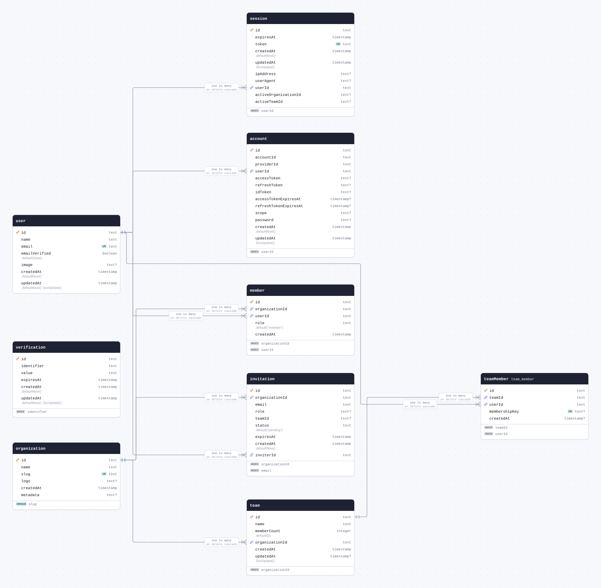
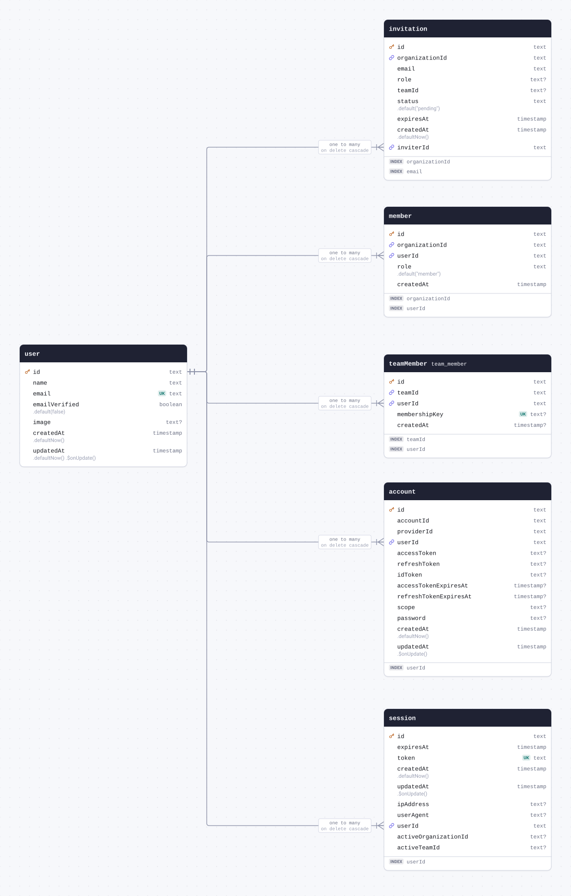
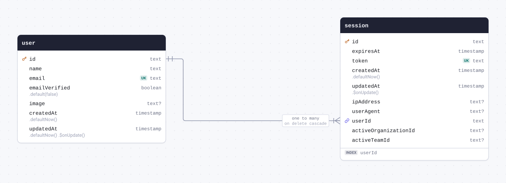
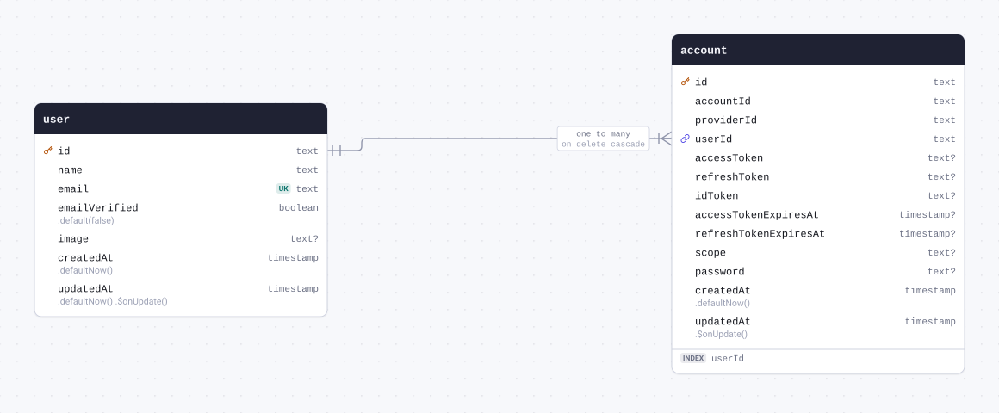
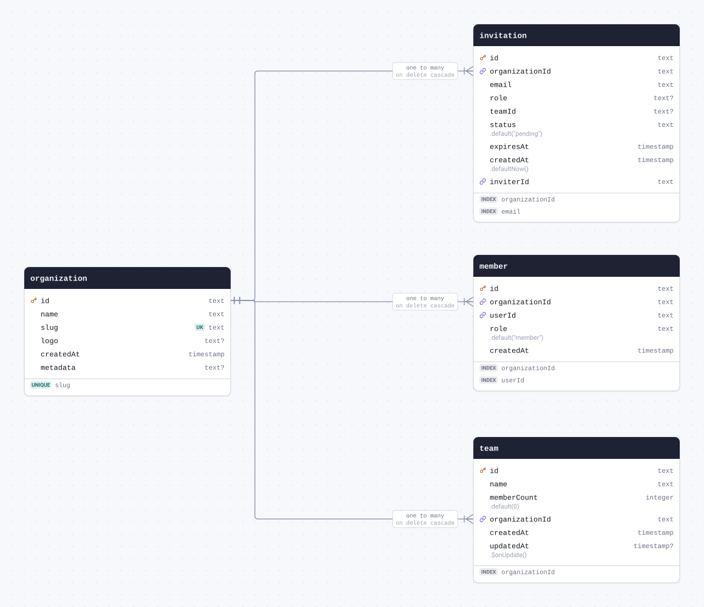
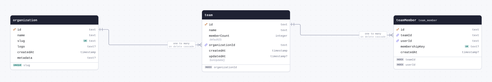
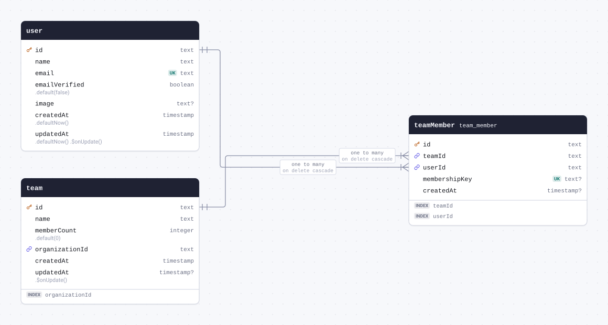
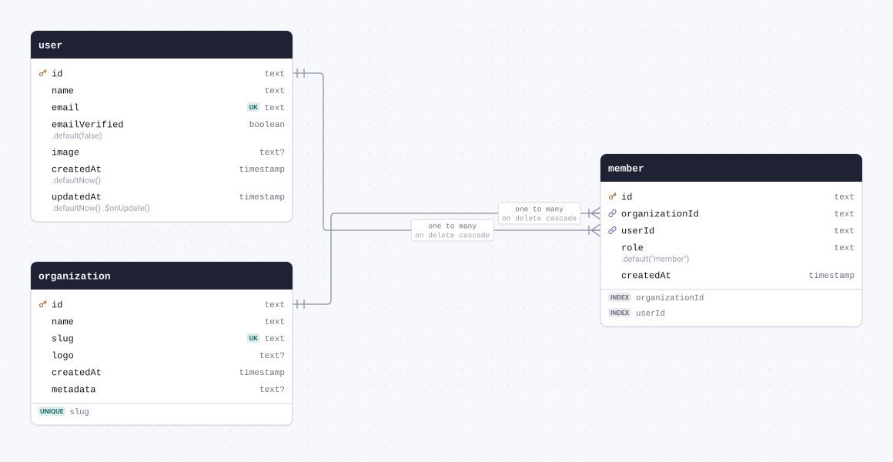
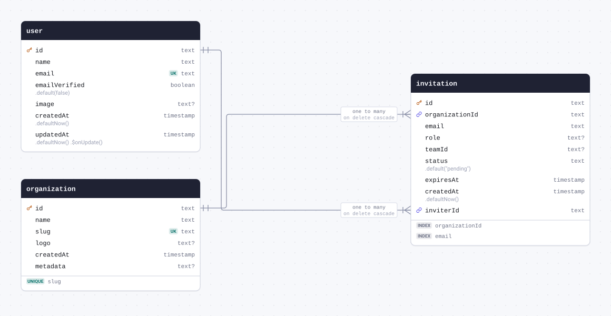

# Schema docs



<details>
<summary>The whole schema as SQL</summary>

```sql
CREATE TABLE "account" (
	"id" text PRIMARY KEY,
	"account_id" text NOT NULL,
	"provider_id" text NOT NULL,
	"user_id" text NOT NULL,
	"access_token" text,
	"refresh_token" text,
	"id_token" text,
	"access_token_expires_at" timestamp,
	"refresh_token_expires_at" timestamp,
	"scope" text,
	"password" text,
	"created_at" timestamp DEFAULT now() NOT NULL,
	"updated_at" timestamp NOT NULL
);

CREATE TABLE "invitation" (
	"id" text PRIMARY KEY,
	"organization_id" text NOT NULL,
	"email" text NOT NULL,
	"role" text,
	"team_id" text,
	"status" text DEFAULT 'pending' NOT NULL,
	"expires_at" timestamp NOT NULL,
	"created_at" timestamp DEFAULT now() NOT NULL,
	"inviter_id" text NOT NULL
);

CREATE TABLE "member" (
	"id" text PRIMARY KEY,
	"organization_id" text NOT NULL,
	"user_id" text NOT NULL,
	"role" text DEFAULT 'member' NOT NULL,
	"created_at" timestamp NOT NULL
);

CREATE TABLE "organization" (
	"id" text PRIMARY KEY,
	"name" text NOT NULL,
	"slug" text NOT NULL UNIQUE,
	"logo" text,
	"created_at" timestamp NOT NULL,
	"metadata" text
);

CREATE TABLE "session" (
	"id" text PRIMARY KEY,
	"expires_at" timestamp NOT NULL,
	"token" text NOT NULL UNIQUE,
	"created_at" timestamp DEFAULT now() NOT NULL,
	"updated_at" timestamp NOT NULL,
	"ip_address" text,
	"user_agent" text,
	"user_id" text NOT NULL,
	"active_organization_id" text,
	"active_team_id" text
);

CREATE TABLE "team" (
	"id" text PRIMARY KEY,
	"name" text NOT NULL,
	"member_count" integer DEFAULT 0 NOT NULL,
	"organization_id" text NOT NULL,
	"created_at" timestamp NOT NULL,
	"updated_at" timestamp
);

CREATE TABLE "team_member" (
	"id" text PRIMARY KEY,
	"team_id" text NOT NULL,
	"user_id" text NOT NULL,
	"membership_key" text UNIQUE,
	"created_at" timestamp
);

CREATE TABLE "user" (
	"id" text PRIMARY KEY,
	"name" text NOT NULL,
	"email" text NOT NULL UNIQUE,
	"email_verified" boolean DEFAULT false NOT NULL,
	"image" text,
	"created_at" timestamp DEFAULT now() NOT NULL,
	"updated_at" timestamp DEFAULT now() NOT NULL
);

CREATE TABLE "verification" (
	"id" text PRIMARY KEY,
	"identifier" text NOT NULL,
	"value" text NOT NULL,
	"expires_at" timestamp NOT NULL,
	"created_at" timestamp DEFAULT now() NOT NULL,
	"updated_at" timestamp DEFAULT now() NOT NULL
);

CREATE INDEX "account_userId_idx" ON "account" ("user_id");

CREATE INDEX "invitation_organizationId_idx" ON "invitation" ("organization_id");

CREATE INDEX "invitation_email_idx" ON "invitation" ("email");

CREATE INDEX "member_organizationId_idx" ON "member" ("organization_id");

CREATE INDEX "member_userId_idx" ON "member" ("user_id");

CREATE UNIQUE INDEX "organization_slug_uidx" ON "organization" ("slug");

CREATE INDEX "session_userId_idx" ON "session" ("user_id");

CREATE INDEX "team_organizationId_idx" ON "team" ("organization_id");

CREATE INDEX "teamMember_teamId_idx" ON "team_member" ("team_id");

CREATE INDEX "teamMember_userId_idx" ON "team_member" ("user_id");

CREATE INDEX "verification_identifier_idx" ON "verification" ("identifier");

ALTER TABLE "account" ADD CONSTRAINT "account_user_id_user_id_fkey" FOREIGN KEY ("user_id") REFERENCES "user"("id") ON DELETE CASCADE;

ALTER TABLE "invitation" ADD CONSTRAINT "invitation_organization_id_organization_id_fkey" FOREIGN KEY ("organization_id") REFERENCES "organization"("id") ON DELETE CASCADE;

ALTER TABLE "invitation" ADD CONSTRAINT "invitation_inviter_id_user_id_fkey" FOREIGN KEY ("inviter_id") REFERENCES "user"("id") ON DELETE CASCADE;

ALTER TABLE "member" ADD CONSTRAINT "member_organization_id_organization_id_fkey" FOREIGN KEY ("organization_id") REFERENCES "organization"("id") ON DELETE CASCADE;

ALTER TABLE "member" ADD CONSTRAINT "member_user_id_user_id_fkey" FOREIGN KEY ("user_id") REFERENCES "user"("id") ON DELETE CASCADE;

ALTER TABLE "session" ADD CONSTRAINT "session_user_id_user_id_fkey" FOREIGN KEY ("user_id") REFERENCES "user"("id") ON DELETE CASCADE;

ALTER TABLE "team" ADD CONSTRAINT "team_organization_id_organization_id_fkey" FOREIGN KEY ("organization_id") REFERENCES "organization"("id") ON DELETE CASCADE;

ALTER TABLE "team_member" ADD CONSTRAINT "team_member_team_id_team_id_fkey" FOREIGN KEY ("team_id") REFERENCES "team"("id") ON DELETE CASCADE;

ALTER TABLE "team_member" ADD CONSTRAINT "team_member_user_id_user_id_fkey" FOREIGN KEY ("user_id") REFERENCES "user"("id") ON DELETE CASCADE;
```

</details>

## Contents

| Table                               | Name in the database | Description |
| ----------------------------------- | -------------------- | ----------- |
| [user](#table-user)                 | `user`               |             |
| [session](#table-session)           | `session`            |             |
| [account](#table-account)           | `account`            |             |
| [verification](#table-verification) | `verification`       |             |
| [organization](#table-organization) | `organization`       |             |
| [team](#table-team)                 | `team`               |             |
| [teamMember](#table-teamMember)     | `team_member`        |             |
| [member](#table-member)             | `member`             |             |
| [invitation](#table-invitation)     | `invitation`         |             |

## Tables

<a id="table-user"></a>

### user



| Column                             | Type        | Constraints     | Default                        | Description |
| ---------------------------------- | ----------- | --------------- | ------------------------------ | ----------- |
| `id`                               | `text`      | PK NOT NULL     |                                |             |
| `name`                             | `text`      | NOT NULL        |                                |             |
| `email`                            | `text`      | UNIQUE NOT NULL |                                |             |
| `emailVerified` (`email_verified`) | `boolean`   | NOT NULL        | `.default(false)`              |             |
| `image`                            | `text`      | NULL            |                                |             |
| `createdAt` (`created_at`)         | `timestamp` | NOT NULL        | `.defaultNow()`                |             |
| `updatedAt` (`updated_at`)         | `timestamp` | NOT NULL        | `.defaultNow()` `.$onUpdate()` |             |

#### Definition

```sql
CREATE TABLE "user" (
	"id" text PRIMARY KEY,
	"name" text NOT NULL,
	"email" text NOT NULL UNIQUE,
	"email_verified" boolean DEFAULT false NOT NULL,
	"image" text,
	"created_at" timestamp DEFAULT now() NOT NULL,
	"updated_at" timestamp DEFAULT now() NOT NULL
);
```

#### Referenced by

- `id` → [session.userId](#table-session) (one to many, on delete cascade)
- `id` → [account.userId](#table-account) (one to many, on delete cascade)
- `id` → [teamMember.userId](#table-teamMember) (one to many, on delete cascade)
- `id` → [member.userId](#table-member) (one to many, on delete cascade)
- `id` → [invitation.inviterId](#table-invitation) (one to many, on delete cascade)

<details>
<summary>Queries and their SQL</summary>

**Select**: Every row of user.

```ts
db.select().from(user);
```

```sql
select "id", "name", "email", "email_verified", "image", "created_at", "updated_at"
from "user"
```

**Count**: How many rows user has.

```ts
db.select({ count: count() }).from(user);
```

```sql
select count(*)
from "user"
```

**Find many with relations**: The rows of user with what they relate to, through the relational query API.

```ts
db.query.user.findMany({
  with: { sessions: true, accounts: true, teamMembers: true, members: true, invitations: true },
});
```

```sql
select "d0"."id" as "id", "d0"."name" as "name", "d0"."email" as "email", "d0"."email_verified" as "emailVerified", "d0"."image" as "image", "d0"."created_at" as "createdAt", "d0"."updated_at" as "updatedAt", "sessions"."r" as "sessions", "accounts"."r" as "accounts", "teamMembers"."r" as "teamMembers", "members"."r" as "members", "invitations"."r" as "invitations"
from "user" as "d0"
left join lateral(select coalesce(json_agg(row_to_json("t".*)), '[]') as "r" from (select "d1"."id" as "id", "d1"."expires_at" as "expiresAt", "d1"."token" as "token", "d1"."created_at" as "createdAt", "d1"."updated_at" as "updatedAt", "d1"."ip_address" as "ipAddress", "d1"."user_agent" as "userAgent", "d1"."user_id" as "userId", "d1"."active_organization_id" as "activeOrganizationId", "d1"."active_team_id" as "activeTeamId" from "session" as "d1" where "d0"."id" = "d1"."user_id") as "t") as "sessions" on true
left join lateral(select coalesce(json_agg(row_to_json("t".*)), '[]') as "r" from (select "d1"."id" as "id", "d1"."account_id" as "accountId", "d1"."provider_id" as "providerId", "d1"."user_id" as "userId", "d1"."access_token" as "accessToken", "d1"."refresh_token" as "refreshToken", "d1"."id_token" as "idToken", "d1"."access_token_expires_at" as "accessTokenExpiresAt", "d1"."refresh_token_expires_at" as "refreshTokenExpiresAt", "d1"."scope" as "scope", "d1"."password" as "password", "d1"."created_at" as "createdAt", "d1"."updated_at" as "updatedAt" from "account" as "d1" where "d0"."id" = "d1"."user_id") as "t") as "accounts" on true
left join lateral(select coalesce(json_agg(row_to_json("t".*)), '[]') as "r" from (select "d1"."id" as "id", "d1"."team_id" as "teamId", "d1"."user_id" as "userId", "d1"."membership_key" as "membershipKey", "d1"."created_at" as "createdAt" from "team_member" as "d1" where "d0"."id" = "d1"."user_id") as "t") as "teamMembers" on true
left join lateral(select coalesce(json_agg(row_to_json("t".*)), '[]') as "r" from (select "d1"."id" as "id", "d1"."organization_id" as "organizationId", "d1"."user_id" as "userId", "d1"."role" as "role", "d1"."created_at" as "createdAt" from "member" as "d1" where "d0"."id" = "d1"."user_id") as "t") as "members" on true
left join lateral(select coalesce(json_agg(row_to_json("t".*)), '[]') as "r" from (select "d1"."id" as "id", "d1"."organization_id" as "organizationId", "d1"."email" as "email", "d1"."role" as "role", "d1"."team_id" as "teamId", "d1"."status" as "status", "d1"."expires_at" as "expiresAt", "d1"."created_at" as "createdAt", "d1"."inviter_id" as "inviterId" from "invitation" as "d1" where "d0"."id" = "d1"."inviter_id") as "t") as "invitations" on true
```

**Find by primary key**: One row of user, through the relational query API.

```ts
db.query.user.findFirst({ where: { id: "id" } });
```

```sql
select "d0"."id" as "id", "d0"."name" as "name", "d0"."email" as "email", "d0"."email_verified" as "emailVerified", "d0"."image" as "image", "d0"."created_at" as "createdAt", "d0"."updated_at" as "updatedAt"
from "user" as "d0"
where "d0"."id" = $1
limit $2
-- params: ["id",1]
```

**Insert**: Adds a row to user, giving the columns that have no default.

```ts
db.insert(user).values({ id: "id", name: "name", email: "email" });
```

```sql
insert into "user" ("id", "name", "email", "email_verified", "image", "created_at", "updated_at")
values ($1, $2, $3, default, default, default, default)
-- params: ["id","name","email"]
```

**Update**: Changes a row of user, found by its primary key.

```ts
db.update(user).set({ name: "name" }).where(eq(user.id, "id"));
```

```sql
update "user"
set "name" = $1, "updated_at" = $2
where "user"."id" = $3
-- params: ["name","2026-01-01T00:00:00.000Z","id"]
```

**Delete**: Deletes a row of user, found by its primary key.

```ts
db.delete(user).where(eq(user.id, "id"));
```

```sql
delete from "user"
where "user"."id" = $1
-- params: ["id"]
```

</details>

<a id="table-session"></a>

### session



| Column                                            | Type        | Constraints                       | Default         | Description |
| ------------------------------------------------- | ----------- | --------------------------------- | --------------- | ----------- |
| `id`                                              | `text`      | PK NOT NULL                       |                 |             |
| `expiresAt` (`expires_at`)                        | `timestamp` | NOT NULL                          |                 |             |
| `token`                                           | `text`      | UNIQUE NOT NULL                   |                 |             |
| `createdAt` (`created_at`)                        | `timestamp` | NOT NULL                          | `.defaultNow()` |             |
| `updatedAt` (`updated_at`)                        | `timestamp` | NOT NULL                          | `.$onUpdate()`  |             |
| `ipAddress` (`ip_address`)                        | `text`      | NULL                              |                 |             |
| `userAgent` (`user_agent`)                        | `text`      | NULL                              |                 |             |
| `userId` (`user_id`)                              | `text`      | NOT NULL → [user.id](#table-user) |                 |             |
| `activeOrganizationId` (`active_organization_id`) | `text`      | NULL                              |                 |             |
| `activeTeamId` (`active_team_id`)                 | `text`      | NULL                              |                 |             |

#### Definition

```sql
CREATE TABLE "session" (
	"id" text PRIMARY KEY,
	"expires_at" timestamp NOT NULL,
	"token" text NOT NULL UNIQUE,
	"created_at" timestamp DEFAULT now() NOT NULL,
	"updated_at" timestamp NOT NULL,
	"ip_address" text,
	"user_agent" text,
	"user_id" text NOT NULL,
	"active_organization_id" text,
	"active_team_id" text
);

CREATE INDEX "session_userId_idx" ON "session" ("user_id");

ALTER TABLE "session" ADD CONSTRAINT "session_user_id_user_id_fkey" FOREIGN KEY ("user_id") REFERENCES "user"("id") ON DELETE CASCADE;
```

#### Indexes

- INDEX `userId`

#### References

- `userId` → [user.id](#table-user) (many to one, on delete cascade)

<details>
<summary>Queries and their SQL</summary>

**Select**: Every row of session.

```ts
db.select().from(session);
```

```sql
select "id", "expires_at", "token", "created_at", "updated_at", "ip_address", "user_agent", "user_id", "active_organization_id", "active_team_id"
from "session"
```

**Count**: How many rows session has.

```ts
db.select({ count: count() }).from(session);
```

```sql
select count(*)
from "session"
```

**Find many with relations**: The rows of session with what they relate to, through the relational query API.

```ts
db.query.session.findMany({ with: { user: true } });
```

```sql
select "d0"."id" as "id", "d0"."expires_at" as "expiresAt", "d0"."token" as "token", "d0"."created_at" as "createdAt", "d0"."updated_at" as "updatedAt", "d0"."ip_address" as "ipAddress", "d0"."user_agent" as "userAgent", "d0"."user_id" as "userId", "d0"."active_organization_id" as "activeOrganizationId", "d0"."active_team_id" as "activeTeamId", "user"."r" as "user"
from "session" as "d0"
left join lateral(select row_to_json("t".*) "r" from (select "d1"."id" as "id", "d1"."name" as "name", "d1"."email" as "email", "d1"."email_verified" as "emailVerified", "d1"."image" as "image", "d1"."created_at" as "createdAt", "d1"."updated_at" as "updatedAt" from "user" as "d1" where "d0"."user_id" = "d1"."id" limit $1) as "t") as "user" on true
-- params: [1]
```

**Find by primary key**: One row of session, through the relational query API.

```ts
db.query.session.findFirst({ where: { id: "id" } });
```

```sql
select "d0"."id" as "id", "d0"."expires_at" as "expiresAt", "d0"."token" as "token", "d0"."created_at" as "createdAt", "d0"."updated_at" as "updatedAt", "d0"."ip_address" as "ipAddress", "d0"."user_agent" as "userAgent", "d0"."user_id" as "userId", "d0"."active_organization_id" as "activeOrganizationId", "d0"."active_team_id" as "activeTeamId"
from "session" as "d0"
where "d0"."id" = $1
limit $2
-- params: ["id",1]
```

**Insert**: Adds a row to session, giving the columns that have no default.

```ts
db.insert(session).values({
  id: "id",
  expiresAt: new Date("2026-01-01T00:00:00.000Z"),
  token: "token",
  updatedAt: new Date("2026-01-01T00:00:00.000Z"),
  userId: "userId",
});
```

```sql
insert into "session" ("id", "expires_at", "token", "created_at", "updated_at", "ip_address", "user_agent", "user_id", "active_organization_id", "active_team_id")
values ($1, $2, $3, default, $4, default, default, $5, default, default)
-- params: ["id","2026-01-01T00:00:00.000Z","token","2026-01-01T00:00:00.000Z","userId"]
```

**Update**: Changes a row of session, found by its primary key.

```ts
db.update(session)
  .set({ expiresAt: new Date("2026-01-01T00:00:00.000Z") })
  .where(eq(session.id, "id"));
```

```sql
update "session"
set "expires_at" = $1, "updated_at" = $2
where "session"."id" = $3
-- params: ["2026-01-01T00:00:00.000Z","2026-01-01T00:00:00.000Z","id"]
```

**Delete**: Deletes a row of session, found by its primary key.

```ts
db.delete(session).where(eq(session.id, "id"));
```

```sql
delete from "session"
where "session"."id" = $1
-- params: ["id"]
```

</details>

<a id="table-account"></a>

### account



| Column                                               | Type        | Constraints                       | Default         | Description |
| ---------------------------------------------------- | ----------- | --------------------------------- | --------------- | ----------- |
| `id`                                                 | `text`      | PK NOT NULL                       |                 |             |
| `accountId` (`account_id`)                           | `text`      | NOT NULL                          |                 |             |
| `providerId` (`provider_id`)                         | `text`      | NOT NULL                          |                 |             |
| `userId` (`user_id`)                                 | `text`      | NOT NULL → [user.id](#table-user) |                 |             |
| `accessToken` (`access_token`)                       | `text`      | NULL                              |                 |             |
| `refreshToken` (`refresh_token`)                     | `text`      | NULL                              |                 |             |
| `idToken` (`id_token`)                               | `text`      | NULL                              |                 |             |
| `accessTokenExpiresAt` (`access_token_expires_at`)   | `timestamp` | NULL                              |                 |             |
| `refreshTokenExpiresAt` (`refresh_token_expires_at`) | `timestamp` | NULL                              |                 |             |
| `scope`                                              | `text`      | NULL                              |                 |             |
| `password`                                           | `text`      | NULL                              |                 |             |
| `createdAt` (`created_at`)                           | `timestamp` | NOT NULL                          | `.defaultNow()` |             |
| `updatedAt` (`updated_at`)                           | `timestamp` | NOT NULL                          | `.$onUpdate()`  |             |

#### Definition

```sql
CREATE TABLE "account" (
	"id" text PRIMARY KEY,
	"account_id" text NOT NULL,
	"provider_id" text NOT NULL,
	"user_id" text NOT NULL,
	"access_token" text,
	"refresh_token" text,
	"id_token" text,
	"access_token_expires_at" timestamp,
	"refresh_token_expires_at" timestamp,
	"scope" text,
	"password" text,
	"created_at" timestamp DEFAULT now() NOT NULL,
	"updated_at" timestamp NOT NULL
);

CREATE INDEX "account_userId_idx" ON "account" ("user_id");

ALTER TABLE "account" ADD CONSTRAINT "account_user_id_user_id_fkey" FOREIGN KEY ("user_id") REFERENCES "user"("id") ON DELETE CASCADE;
```

#### Indexes

- INDEX `userId`

#### References

- `userId` → [user.id](#table-user) (many to one, on delete cascade)

<details>
<summary>Queries and their SQL</summary>

**Select**: Every row of account.

```ts
db.select().from(account);
```

```sql
select "id", "account_id", "provider_id", "user_id", "access_token", "refresh_token", "id_token", "access_token_expires_at", "refresh_token_expires_at", "scope", "password", "created_at", "updated_at"
from "account"
```

**Count**: How many rows account has.

```ts
db.select({ count: count() }).from(account);
```

```sql
select count(*)
from "account"
```

**Find many with relations**: The rows of account with what they relate to, through the relational query API.

```ts
db.query.account.findMany({ with: { user: true } });
```

```sql
select "d0"."id" as "id", "d0"."account_id" as "accountId", "d0"."provider_id" as "providerId", "d0"."user_id" as "userId", "d0"."access_token" as "accessToken", "d0"."refresh_token" as "refreshToken", "d0"."id_token" as "idToken", "d0"."access_token_expires_at" as "accessTokenExpiresAt", "d0"."refresh_token_expires_at" as "refreshTokenExpiresAt", "d0"."scope" as "scope", "d0"."password" as "password", "d0"."created_at" as "createdAt", "d0"."updated_at" as "updatedAt", "user"."r" as "user"
from "account" as "d0"
left join lateral(select row_to_json("t".*) "r" from (select "d1"."id" as "id", "d1"."name" as "name", "d1"."email" as "email", "d1"."email_verified" as "emailVerified", "d1"."image" as "image", "d1"."created_at" as "createdAt", "d1"."updated_at" as "updatedAt" from "user" as "d1" where "d0"."user_id" = "d1"."id" limit $1) as "t") as "user" on true
-- params: [1]
```

**Find by primary key**: One row of account, through the relational query API.

```ts
db.query.account.findFirst({ where: { id: "id" } });
```

```sql
select "d0"."id" as "id", "d0"."account_id" as "accountId", "d0"."provider_id" as "providerId", "d0"."user_id" as "userId", "d0"."access_token" as "accessToken", "d0"."refresh_token" as "refreshToken", "d0"."id_token" as "idToken", "d0"."access_token_expires_at" as "accessTokenExpiresAt", "d0"."refresh_token_expires_at" as "refreshTokenExpiresAt", "d0"."scope" as "scope", "d0"."password" as "password", "d0"."created_at" as "createdAt", "d0"."updated_at" as "updatedAt"
from "account" as "d0"
where "d0"."id" = $1
limit $2
-- params: ["id",1]
```

**Insert**: Adds a row to account, giving the columns that have no default.

```ts
db.insert(account).values({
  id: "id",
  accountId: "accountId",
  providerId: "providerId",
  userId: "userId",
  updatedAt: new Date("2026-01-01T00:00:00.000Z"),
});
```

```sql
insert into "account" ("id", "account_id", "provider_id", "user_id", "access_token", "refresh_token", "id_token", "access_token_expires_at", "refresh_token_expires_at", "scope", "password", "created_at", "updated_at")
values ($1, $2, $3, $4, default, default, default, default, default, default, default, default, $5)
-- params: ["id","accountId","providerId","userId","2026-01-01T00:00:00.000Z"]
```

**Update**: Changes a row of account, found by its primary key.

```ts
db.update(account).set({ accountId: "accountId" }).where(eq(account.id, "id"));
```

```sql
update "account"
set "account_id" = $1, "updated_at" = $2
where "account"."id" = $3
-- params: ["accountId","2026-01-01T00:00:00.000Z","id"]
```

**Delete**: Deletes a row of account, found by its primary key.

```ts
db.delete(account).where(eq(account.id, "id"));
```

```sql
delete from "account"
where "account"."id" = $1
-- params: ["id"]
```

</details>

<a id="table-verification"></a>

### verification

| Column                     | Type        | Constraints | Default                        | Description |
| -------------------------- | ----------- | ----------- | ------------------------------ | ----------- |
| `id`                       | `text`      | PK NOT NULL |                                |             |
| `identifier`               | `text`      | NOT NULL    |                                |             |
| `value`                    | `text`      | NOT NULL    |                                |             |
| `expiresAt` (`expires_at`) | `timestamp` | NOT NULL    |                                |             |
| `createdAt` (`created_at`) | `timestamp` | NOT NULL    | `.defaultNow()`                |             |
| `updatedAt` (`updated_at`) | `timestamp` | NOT NULL    | `.defaultNow()` `.$onUpdate()` |             |

#### Definition

```sql
CREATE TABLE "verification" (
	"id" text PRIMARY KEY,
	"identifier" text NOT NULL,
	"value" text NOT NULL,
	"expires_at" timestamp NOT NULL,
	"created_at" timestamp DEFAULT now() NOT NULL,
	"updated_at" timestamp DEFAULT now() NOT NULL
);

CREATE INDEX "verification_identifier_idx" ON "verification" ("identifier");
```

#### Indexes

- INDEX `identifier`

<details>
<summary>Queries and their SQL</summary>

**Select**: Every row of verification.

```ts
db.select().from(verification);
```

```sql
select "id", "identifier", "value", "expires_at", "created_at", "updated_at"
from "verification"
```

**Count**: How many rows verification has.

```ts
db.select({ count: count() }).from(verification);
```

```sql
select count(*)
from "verification"
```

**Find many**: The rows of verification, through the relational query API.

```ts
db.query.verification.findMany();
```

```sql
select "d0"."id" as "id", "d0"."identifier" as "identifier", "d0"."value" as "value", "d0"."expires_at" as "expiresAt", "d0"."created_at" as "createdAt", "d0"."updated_at" as "updatedAt"
from "verification" as "d0"
```

**Find by primary key**: One row of verification, through the relational query API.

```ts
db.query.verification.findFirst({ where: { id: "id" } });
```

```sql
select "d0"."id" as "id", "d0"."identifier" as "identifier", "d0"."value" as "value", "d0"."expires_at" as "expiresAt", "d0"."created_at" as "createdAt", "d0"."updated_at" as "updatedAt"
from "verification" as "d0"
where "d0"."id" = $1
limit $2
-- params: ["id",1]
```

**Insert**: Adds a row to verification, giving the columns that have no default.

```ts
db.insert(verification).values({
  id: "id",
  identifier: "identifier",
  value: "value",
  expiresAt: new Date("2026-01-01T00:00:00.000Z"),
});
```

```sql
insert into "verification" ("id", "identifier", "value", "expires_at", "created_at", "updated_at")
values ($1, $2, $3, $4, default, default)
-- params: ["id","identifier","value","2026-01-01T00:00:00.000Z"]
```

**Update**: Changes a row of verification, found by its primary key.

```ts
db.update(verification).set({ identifier: "identifier" }).where(eq(verification.id, "id"));
```

```sql
update "verification"
set "identifier" = $1, "updated_at" = $2
where "verification"."id" = $3
-- params: ["identifier","2026-01-01T00:00:00.000Z","id"]
```

**Delete**: Deletes a row of verification, found by its primary key.

```ts
db.delete(verification).where(eq(verification.id, "id"));
```

```sql
delete from "verification"
where "verification"."id" = $1
-- params: ["id"]
```

</details>

<a id="table-organization"></a>

### organization



| Column                     | Type        | Constraints     | Default | Description |
| -------------------------- | ----------- | --------------- | ------- | ----------- |
| `id`                       | `text`      | PK NOT NULL     |         |             |
| `name`                     | `text`      | NOT NULL        |         |             |
| `slug`                     | `text`      | UNIQUE NOT NULL |         |             |
| `logo`                     | `text`      | NULL            |         |             |
| `createdAt` (`created_at`) | `timestamp` | NOT NULL        |         |             |
| `metadata`                 | `text`      | NULL            |         |             |

#### Definition

```sql
CREATE TABLE "organization" (
	"id" text PRIMARY KEY,
	"name" text NOT NULL,
	"slug" text NOT NULL UNIQUE,
	"logo" text,
	"created_at" timestamp NOT NULL,
	"metadata" text
);

CREATE UNIQUE INDEX "organization_slug_uidx" ON "organization" ("slug");
```

#### Indexes

- UNIQUE `slug`

#### Referenced by

- `id` → [team.organizationId](#table-team) (one to many, on delete cascade)
- `id` → [member.organizationId](#table-member) (one to many, on delete cascade)
- `id` → [invitation.organizationId](#table-invitation) (one to many, on delete cascade)

<details>
<summary>Queries and their SQL</summary>

**Select**: Every row of organization.

```ts
db.select().from(organization);
```

```sql
select "id", "name", "slug", "logo", "created_at", "metadata"
from "organization"
```

**Count**: How many rows organization has.

```ts
db.select({ count: count() }).from(organization);
```

```sql
select count(*)
from "organization"
```

**Find many with relations**: The rows of organization with what they relate to, through the relational query API.

```ts
db.query.organization.findMany({ with: { teams: true, members: true, invitations: true } });
```

```sql
select "d0"."id" as "id", "d0"."name" as "name", "d0"."slug" as "slug", "d0"."logo" as "logo", "d0"."created_at" as "createdAt", "d0"."metadata" as "metadata", "teams"."r" as "teams", "members"."r" as "members", "invitations"."r" as "invitations"
from "organization" as "d0"
left join lateral(select coalesce(json_agg(row_to_json("t".*)), '[]') as "r" from (select "d1"."id" as "id", "d1"."name" as "name", "d1"."member_count" as "memberCount", "d1"."organization_id" as "organizationId", "d1"."created_at" as "createdAt", "d1"."updated_at" as "updatedAt" from "team" as "d1" where "d0"."id" = "d1"."organization_id") as "t") as "teams" on true
left join lateral(select coalesce(json_agg(row_to_json("t".*)), '[]') as "r" from (select "d1"."id" as "id", "d1"."organization_id" as "organizationId", "d1"."user_id" as "userId", "d1"."role" as "role", "d1"."created_at" as "createdAt" from "member" as "d1" where "d0"."id" = "d1"."organization_id") as "t") as "members" on true
left join lateral(select coalesce(json_agg(row_to_json("t".*)), '[]') as "r" from (select "d1"."id" as "id", "d1"."organization_id" as "organizationId", "d1"."email" as "email", "d1"."role" as "role", "d1"."team_id" as "teamId", "d1"."status" as "status", "d1"."expires_at" as "expiresAt", "d1"."created_at" as "createdAt", "d1"."inviter_id" as "inviterId" from "invitation" as "d1" where "d0"."id" = "d1"."organization_id") as "t") as "invitations" on true
```

**Find by primary key**: One row of organization, through the relational query API.

```ts
db.query.organization.findFirst({ where: { id: "id" } });
```

```sql
select "d0"."id" as "id", "d0"."name" as "name", "d0"."slug" as "slug", "d0"."logo" as "logo", "d0"."created_at" as "createdAt", "d0"."metadata" as "metadata"
from "organization" as "d0"
where "d0"."id" = $1
limit $2
-- params: ["id",1]
```

**Insert**: Adds a row to organization, giving the columns that have no default.

```ts
db.insert(organization).values({
  id: "id",
  name: "name",
  slug: "slug",
  createdAt: new Date("2026-01-01T00:00:00.000Z"),
});
```

```sql
insert into "organization" ("id", "name", "slug", "logo", "created_at", "metadata")
values ($1, $2, $3, default, $4, default)
-- params: ["id","name","slug","2026-01-01T00:00:00.000Z"]
```

**Update**: Changes a row of organization, found by its primary key.

```ts
db.update(organization).set({ name: "name" }).where(eq(organization.id, "id"));
```

```sql
update "organization"
set "name" = $1
where "organization"."id" = $2
-- params: ["name","id"]
```

**Delete**: Deletes a row of organization, found by its primary key.

```ts
db.delete(organization).where(eq(organization.id, "id"));
```

```sql
delete from "organization"
where "organization"."id" = $1
-- params: ["id"]
```

</details>

<a id="table-team"></a>

### team



| Column                               | Type        | Constraints                                       | Default        | Description |
| ------------------------------------ | ----------- | ------------------------------------------------- | -------------- | ----------- |
| `id`                                 | `text`      | PK NOT NULL                                       |                |             |
| `name`                               | `text`      | NOT NULL                                          |                |             |
| `memberCount` (`member_count`)       | `integer`   | NOT NULL                                          | `.default(0)`  |             |
| `organizationId` (`organization_id`) | `text`      | NOT NULL → [organization.id](#table-organization) |                |             |
| `createdAt` (`created_at`)           | `timestamp` | NOT NULL                                          |                |             |
| `updatedAt` (`updated_at`)           | `timestamp` | NULL                                              | `.$onUpdate()` |             |

#### Definition

```sql
CREATE TABLE "team" (
	"id" text PRIMARY KEY,
	"name" text NOT NULL,
	"member_count" integer DEFAULT 0 NOT NULL,
	"organization_id" text NOT NULL,
	"created_at" timestamp NOT NULL,
	"updated_at" timestamp
);

CREATE INDEX "team_organizationId_idx" ON "team" ("organization_id");

ALTER TABLE "team" ADD CONSTRAINT "team_organization_id_organization_id_fkey" FOREIGN KEY ("organization_id") REFERENCES "organization"("id") ON DELETE CASCADE;
```

#### Indexes

- INDEX `organizationId`

#### References

- `organizationId` → [organization.id](#table-organization) (many to one, on delete cascade)

#### Referenced by

- `id` → [teamMember.teamId](#table-teamMember) (one to many, on delete cascade)

<details>
<summary>Queries and their SQL</summary>

**Select**: Every row of team.

```ts
db.select().from(team);
```

```sql
select "id", "name", "member_count", "organization_id", "created_at", "updated_at"
from "team"
```

**Count**: How many rows team has.

```ts
db.select({ count: count() }).from(team);
```

```sql
select count(*)
from "team"
```

**Find many with relations**: The rows of team with what they relate to, through the relational query API.

```ts
db.query.team.findMany({ with: { organization: true, teamMembers: true } });
```

```sql
select "d0"."id" as "id", "d0"."name" as "name", "d0"."member_count" as "memberCount", "d0"."organization_id" as "organizationId", "d0"."created_at" as "createdAt", "d0"."updated_at" as "updatedAt", "organization"."r" as "organization", "teamMembers"."r" as "teamMembers"
from "team" as "d0"
left join lateral(select row_to_json("t".*) "r" from (select "d1"."id" as "id", "d1"."name" as "name", "d1"."slug" as "slug", "d1"."logo" as "logo", "d1"."created_at" as "createdAt", "d1"."metadata" as "metadata" from "organization" as "d1" where "d0"."organization_id" = "d1"."id" limit $1) as "t") as "organization" on true
left join lateral(select coalesce(json_agg(row_to_json("t".*)), '[]') as "r" from (select "d1"."id" as "id", "d1"."team_id" as "teamId", "d1"."user_id" as "userId", "d1"."membership_key" as "membershipKey", "d1"."created_at" as "createdAt" from "team_member" as "d1" where "d0"."id" = "d1"."team_id") as "t") as "teamMembers" on true
-- params: [1]
```

**Find by primary key**: One row of team, through the relational query API.

```ts
db.query.team.findFirst({ where: { id: "id" } });
```

```sql
select "d0"."id" as "id", "d0"."name" as "name", "d0"."member_count" as "memberCount", "d0"."organization_id" as "organizationId", "d0"."created_at" as "createdAt", "d0"."updated_at" as "updatedAt"
from "team" as "d0"
where "d0"."id" = $1
limit $2
-- params: ["id",1]
```

**Insert**: Adds a row to team, giving the columns that have no default.

```ts
db.insert(team).values({
  id: "id",
  name: "name",
  organizationId: "organizationId",
  createdAt: new Date("2026-01-01T00:00:00.000Z"),
});
```

```sql
insert into "team" ("id", "name", "member_count", "organization_id", "created_at", "updated_at")
values ($1, $2, default, $3, $4, $5)
-- params: ["id","name","organizationId","2026-01-01T00:00:00.000Z","2026-01-01T00:00:00.000Z"]
```

**Update**: Changes a row of team, found by its primary key.

```ts
db.update(team).set({ name: "name" }).where(eq(team.id, "id"));
```

```sql
update "team"
set "name" = $1, "updated_at" = $2
where "team"."id" = $3
-- params: ["name","2026-01-01T00:00:00.000Z","id"]
```

**Delete**: Deletes a row of team, found by its primary key.

```ts
db.delete(team).where(eq(team.id, "id"));
```

```sql
delete from "team"
where "team"."id" = $1
-- params: ["id"]
```

</details>

<a id="table-teamMember"></a>

### teamMember

Table `team_member`.



| Column                             | Type        | Constraints                       | Default | Description |
| ---------------------------------- | ----------- | --------------------------------- | ------- | ----------- |
| `id`                               | `text`      | PK NOT NULL                       |         |             |
| `teamId` (`team_id`)               | `text`      | NOT NULL → [team.id](#table-team) |         |             |
| `userId` (`user_id`)               | `text`      | NOT NULL → [user.id](#table-user) |         |             |
| `membershipKey` (`membership_key`) | `text`      | UNIQUE NULL                       |         |             |
| `createdAt` (`created_at`)         | `timestamp` | NULL                              |         |             |

#### Definition

```sql
CREATE TABLE "team_member" (
	"id" text PRIMARY KEY,
	"team_id" text NOT NULL,
	"user_id" text NOT NULL,
	"membership_key" text UNIQUE,
	"created_at" timestamp
);

CREATE INDEX "teamMember_teamId_idx" ON "team_member" ("team_id");

CREATE INDEX "teamMember_userId_idx" ON "team_member" ("user_id");

ALTER TABLE "team_member" ADD CONSTRAINT "team_member_team_id_team_id_fkey" FOREIGN KEY ("team_id") REFERENCES "team"("id") ON DELETE CASCADE;

ALTER TABLE "team_member" ADD CONSTRAINT "team_member_user_id_user_id_fkey" FOREIGN KEY ("user_id") REFERENCES "user"("id") ON DELETE CASCADE;
```

#### Indexes

- INDEX `teamId`
- INDEX `userId`

#### References

- `teamId` → [team.id](#table-team) (many to one, on delete cascade)
- `userId` → [user.id](#table-user) (many to one, on delete cascade)

<details>
<summary>Queries and their SQL</summary>

**Select**: Every row of teamMember.

```ts
db.select().from(teamMember);
```

```sql
select "id", "team_id", "user_id", "membership_key", "created_at"
from "team_member"
```

**Count**: How many rows teamMember has.

```ts
db.select({ count: count() }).from(teamMember);
```

```sql
select count(*)
from "team_member"
```

**Find many with relations**: The rows of teamMember with what they relate to, through the relational query API.

```ts
db.query.teamMember.findMany({ with: { team: true, user: true } });
```

```sql
select "d0"."id" as "id", "d0"."team_id" as "teamId", "d0"."user_id" as "userId", "d0"."membership_key" as "membershipKey", "d0"."created_at" as "createdAt", "team"."r" as "team", "user"."r" as "user"
from "team_member" as "d0"
left join lateral(select row_to_json("t".*) "r" from (select "d1"."id" as "id", "d1"."name" as "name", "d1"."member_count" as "memberCount", "d1"."organization_id" as "organizationId", "d1"."created_at" as "createdAt", "d1"."updated_at" as "updatedAt" from "team" as "d1" where "d0"."team_id" = "d1"."id" limit $1) as "t") as "team" on true
left join lateral(select row_to_json("t".*) "r" from (select "d1"."id" as "id", "d1"."name" as "name", "d1"."email" as "email", "d1"."email_verified" as "emailVerified", "d1"."image" as "image", "d1"."created_at" as "createdAt", "d1"."updated_at" as "updatedAt" from "user" as "d1" where "d0"."user_id" = "d1"."id" limit $2) as "t") as "user" on true
-- params: [1,1]
```

**Find by primary key**: One row of teamMember, through the relational query API.

```ts
db.query.teamMember.findFirst({ where: { id: "id" } });
```

```sql
select "d0"."id" as "id", "d0"."team_id" as "teamId", "d0"."user_id" as "userId", "d0"."membership_key" as "membershipKey", "d0"."created_at" as "createdAt"
from "team_member" as "d0"
where "d0"."id" = $1
limit $2
-- params: ["id",1]
```

**Insert**: Adds a row to teamMember, giving the columns that have no default.

```ts
db.insert(teamMember).values({ id: "id", teamId: "teamId", userId: "userId" });
```

```sql
insert into "team_member" ("id", "team_id", "user_id", "membership_key", "created_at")
values ($1, $2, $3, default, default)
-- params: ["id","teamId","userId"]
```

**Update**: Changes a row of teamMember, found by its primary key.

```ts
db.update(teamMember).set({ teamId: "teamId" }).where(eq(teamMember.id, "id"));
```

```sql
update "team_member"
set "team_id" = $1
where "team_member"."id" = $2
-- params: ["teamId","id"]
```

**Delete**: Deletes a row of teamMember, found by its primary key.

```ts
db.delete(teamMember).where(eq(teamMember.id, "id"));
```

```sql
delete from "team_member"
where "team_member"."id" = $1
-- params: ["id"]
```

</details>

<a id="table-member"></a>

### member



| Column                               | Type        | Constraints                                       | Default              | Description |
| ------------------------------------ | ----------- | ------------------------------------------------- | -------------------- | ----------- |
| `id`                                 | `text`      | PK NOT NULL                                       |                      |             |
| `organizationId` (`organization_id`) | `text`      | NOT NULL → [organization.id](#table-organization) |                      |             |
| `userId` (`user_id`)                 | `text`      | NOT NULL → [user.id](#table-user)                 |                      |             |
| `role`                               | `text`      | NOT NULL                                          | `.default("member")` |             |
| `createdAt` (`created_at`)           | `timestamp` | NOT NULL                                          |                      |             |

#### Definition

```sql
CREATE TABLE "member" (
	"id" text PRIMARY KEY,
	"organization_id" text NOT NULL,
	"user_id" text NOT NULL,
	"role" text DEFAULT 'member' NOT NULL,
	"created_at" timestamp NOT NULL
);

CREATE INDEX "member_organizationId_idx" ON "member" ("organization_id");

CREATE INDEX "member_userId_idx" ON "member" ("user_id");

ALTER TABLE "member" ADD CONSTRAINT "member_organization_id_organization_id_fkey" FOREIGN KEY ("organization_id") REFERENCES "organization"("id") ON DELETE CASCADE;

ALTER TABLE "member" ADD CONSTRAINT "member_user_id_user_id_fkey" FOREIGN KEY ("user_id") REFERENCES "user"("id") ON DELETE CASCADE;
```

#### Indexes

- INDEX `organizationId`
- INDEX `userId`

#### References

- `organizationId` → [organization.id](#table-organization) (many to one, on delete cascade)
- `userId` → [user.id](#table-user) (many to one, on delete cascade)

<details>
<summary>Queries and their SQL</summary>

**Select**: Every row of member.

```ts
db.select().from(member);
```

```sql
select "id", "organization_id", "user_id", "role", "created_at"
from "member"
```

**Count**: How many rows member has.

```ts
db.select({ count: count() }).from(member);
```

```sql
select count(*)
from "member"
```

**Find many with relations**: The rows of member with what they relate to, through the relational query API.

```ts
db.query.member.findMany({ with: { organization: true, user: true } });
```

```sql
select "d0"."id" as "id", "d0"."organization_id" as "organizationId", "d0"."user_id" as "userId", "d0"."role" as "role", "d0"."created_at" as "createdAt", "organization"."r" as "organization", "user"."r" as "user"
from "member" as "d0"
left join lateral(select row_to_json("t".*) "r" from (select "d1"."id" as "id", "d1"."name" as "name", "d1"."slug" as "slug", "d1"."logo" as "logo", "d1"."created_at" as "createdAt", "d1"."metadata" as "metadata" from "organization" as "d1" where "d0"."organization_id" = "d1"."id" limit $1) as "t") as "organization" on true
left join lateral(select row_to_json("t".*) "r" from (select "d1"."id" as "id", "d1"."name" as "name", "d1"."email" as "email", "d1"."email_verified" as "emailVerified", "d1"."image" as "image", "d1"."created_at" as "createdAt", "d1"."updated_at" as "updatedAt" from "user" as "d1" where "d0"."user_id" = "d1"."id" limit $2) as "t") as "user" on true
-- params: [1,1]
```

**Find by primary key**: One row of member, through the relational query API.

```ts
db.query.member.findFirst({ where: { id: "id" } });
```

```sql
select "d0"."id" as "id", "d0"."organization_id" as "organizationId", "d0"."user_id" as "userId", "d0"."role" as "role", "d0"."created_at" as "createdAt"
from "member" as "d0"
where "d0"."id" = $1
limit $2
-- params: ["id",1]
```

**Insert**: Adds a row to member, giving the columns that have no default.

```ts
db.insert(member).values({
  id: "id",
  organizationId: "organizationId",
  userId: "userId",
  createdAt: new Date("2026-01-01T00:00:00.000Z"),
});
```

```sql
insert into "member" ("id", "organization_id", "user_id", "role", "created_at")
values ($1, $2, $3, default, $4)
-- params: ["id","organizationId","userId","2026-01-01T00:00:00.000Z"]
```

**Update**: Changes a row of member, found by its primary key.

```ts
db.update(member).set({ organizationId: "organizationId" }).where(eq(member.id, "id"));
```

```sql
update "member"
set "organization_id" = $1
where "member"."id" = $2
-- params: ["organizationId","id"]
```

**Delete**: Deletes a row of member, found by its primary key.

```ts
db.delete(member).where(eq(member.id, "id"));
```

```sql
delete from "member"
where "member"."id" = $1
-- params: ["id"]
```

</details>

<a id="table-invitation"></a>

### invitation



| Column                               | Type        | Constraints                                       | Default               | Description |
| ------------------------------------ | ----------- | ------------------------------------------------- | --------------------- | ----------- |
| `id`                                 | `text`      | PK NOT NULL                                       |                       |             |
| `organizationId` (`organization_id`) | `text`      | NOT NULL → [organization.id](#table-organization) |                       |             |
| `email`                              | `text`      | NOT NULL                                          |                       |             |
| `role`                               | `text`      | NULL                                              |                       |             |
| `teamId` (`team_id`)                 | `text`      | NULL                                              |                       |             |
| `status`                             | `text`      | NOT NULL                                          | `.default("pending")` |             |
| `expiresAt` (`expires_at`)           | `timestamp` | NOT NULL                                          |                       |             |
| `createdAt` (`created_at`)           | `timestamp` | NOT NULL                                          | `.defaultNow()`       |             |
| `inviterId` (`inviter_id`)           | `text`      | NOT NULL → [user.id](#table-user)                 |                       |             |

#### Definition

```sql
CREATE TABLE "invitation" (
	"id" text PRIMARY KEY,
	"organization_id" text NOT NULL,
	"email" text NOT NULL,
	"role" text,
	"team_id" text,
	"status" text DEFAULT 'pending' NOT NULL,
	"expires_at" timestamp NOT NULL,
	"created_at" timestamp DEFAULT now() NOT NULL,
	"inviter_id" text NOT NULL
);

CREATE INDEX "invitation_organizationId_idx" ON "invitation" ("organization_id");

CREATE INDEX "invitation_email_idx" ON "invitation" ("email");

ALTER TABLE "invitation" ADD CONSTRAINT "invitation_organization_id_organization_id_fkey" FOREIGN KEY ("organization_id") REFERENCES "organization"("id") ON DELETE CASCADE;

ALTER TABLE "invitation" ADD CONSTRAINT "invitation_inviter_id_user_id_fkey" FOREIGN KEY ("inviter_id") REFERENCES "user"("id") ON DELETE CASCADE;
```

#### Indexes

- INDEX `organizationId`
- INDEX `email`

#### References

- `organizationId` → [organization.id](#table-organization) (many to one, on delete cascade)
- `inviterId` → [user.id](#table-user) (many to one, on delete cascade)

<details>
<summary>Queries and their SQL</summary>

**Select**: Every row of invitation.

```ts
db.select().from(invitation);
```

```sql
select "id", "organization_id", "email", "role", "team_id", "status", "expires_at", "created_at", "inviter_id"
from "invitation"
```

**Count**: How many rows invitation has.

```ts
db.select({ count: count() }).from(invitation);
```

```sql
select count(*)
from "invitation"
```

**Find many with relations**: The rows of invitation with what they relate to, through the relational query API.

```ts
db.query.invitation.findMany({ with: { organization: true, user: true } });
```

```sql
select "d0"."id" as "id", "d0"."organization_id" as "organizationId", "d0"."email" as "email", "d0"."role" as "role", "d0"."team_id" as "teamId", "d0"."status" as "status", "d0"."expires_at" as "expiresAt", "d0"."created_at" as "createdAt", "d0"."inviter_id" as "inviterId", "organization"."r" as "organization", "user"."r" as "user"
from "invitation" as "d0"
left join lateral(select row_to_json("t".*) "r" from (select "d1"."id" as "id", "d1"."name" as "name", "d1"."slug" as "slug", "d1"."logo" as "logo", "d1"."created_at" as "createdAt", "d1"."metadata" as "metadata" from "organization" as "d1" where "d0"."organization_id" = "d1"."id" limit $1) as "t") as "organization" on true
left join lateral(select row_to_json("t".*) "r" from (select "d1"."id" as "id", "d1"."name" as "name", "d1"."email" as "email", "d1"."email_verified" as "emailVerified", "d1"."image" as "image", "d1"."created_at" as "createdAt", "d1"."updated_at" as "updatedAt" from "user" as "d1" where "d0"."inviter_id" = "d1"."id" limit $2) as "t") as "user" on true
-- params: [1,1]
```

**Find by primary key**: One row of invitation, through the relational query API.

```ts
db.query.invitation.findFirst({ where: { id: "id" } });
```

```sql
select "d0"."id" as "id", "d0"."organization_id" as "organizationId", "d0"."email" as "email", "d0"."role" as "role", "d0"."team_id" as "teamId", "d0"."status" as "status", "d0"."expires_at" as "expiresAt", "d0"."created_at" as "createdAt", "d0"."inviter_id" as "inviterId"
from "invitation" as "d0"
where "d0"."id" = $1
limit $2
-- params: ["id",1]
```

**Insert**: Adds a row to invitation, giving the columns that have no default.

```ts
db.insert(invitation).values({
  id: "id",
  organizationId: "organizationId",
  email: "email",
  expiresAt: new Date("2026-01-01T00:00:00.000Z"),
  inviterId: "inviterId",
});
```

```sql
insert into "invitation" ("id", "organization_id", "email", "role", "team_id", "status", "expires_at", "created_at", "inviter_id")
values ($1, $2, $3, default, default, default, $4, default, $5)
-- params: ["id","organizationId","email","2026-01-01T00:00:00.000Z","inviterId"]
```

**Update**: Changes a row of invitation, found by its primary key.

```ts
db.update(invitation).set({ organizationId: "organizationId" }).where(eq(invitation.id, "id"));
```

```sql
update "invitation"
set "organization_id" = $1
where "invitation"."id" = $2
-- params: ["organizationId","id"]
```

**Delete**: Deletes a row of invitation, found by its primary key.

```ts
db.delete(invitation).where(eq(invitation.id, "id"));
```

```sql
delete from "invitation"
where "invitation"."id" = $1
-- params: ["id"]
```

</details>
