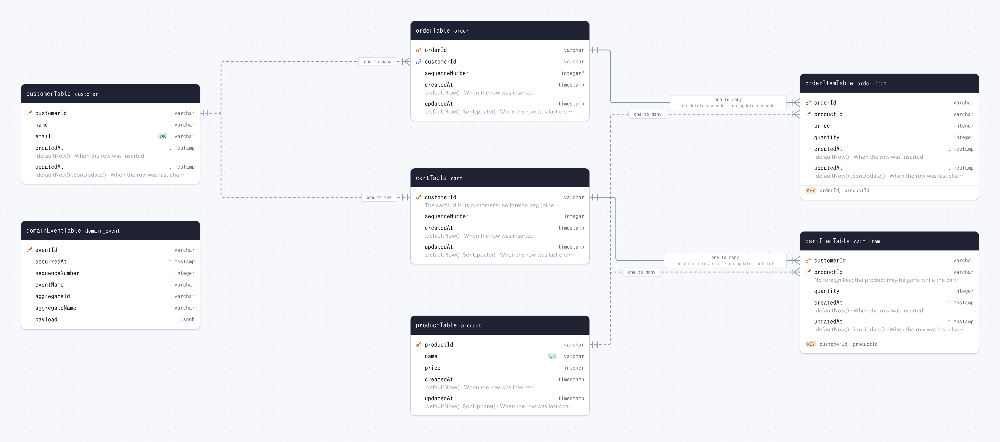

# Drizzler

**[Drizzler](https://www.npmjs.com/package/drizzler)** reads a [Drizzle](https://orm.drizzle.team/) schema — one file or many, with the comments you already write as its descriptions — into ER diagrams and DBML, and opens it in a local studio.



- 📊 ER diagrams as SVG / PNG (light and dark) and [Mermaid](https://mermaid.js.org/), and [DBML](https://dbml.dbdiagram.io/)
- 🗂️ Schemas split over files: a directory, a glob, or the `schema` of `drizzle.config.ts`
- 🔗 [Relations v2](https://orm.drizzle.team/docs/relations) (`defineRelations`) drawn even where no foreign key exists
- ✏️ `drizzler studio`: the schema beside its live diagram, its docs, the data, Drizzle queries and SQL
- 🌱 `drizzler seed`: rows from [faker](https://fakerjs.dev/) or your own, keeping every key

## Quick Start

```bash
npm install -D drizzler
```

```bash
npx drizzler db/schema.ts -o docs/er.svg   # .svg / .png, .md (Mermaid) or .dbml
npx drizzler -o docs/ER.md                 # the schema of drizzle.config.ts
npx drizzler studio db/schema.ts --url file:./dev.db
npx drizzler seed
```

`drizzler seed` inserts the rows `drizzler.config.ts` describes:

```ts
import { defineConfig } from "drizzler";

import * as schema from "./db/schema";

export default defineConfig(schema, {
  url: "file:./dev.db",
  seed: 42,
  models: { user: { count: 20 }, post: { count: 40 } },
});
```

## Documentation

- [Diagrams and DBML](https://github.com/nakita628/drizzler/blob/main/packages/drizzler/docs/generate.md): the command line, schemas split over files, comments, relations
- [Studio](https://github.com/nakita628/drizzler/blob/main/packages/drizzler/docs/studio.md)
- [Seed](https://github.com/nakita628/drizzler/blob/main/packages/drizzler/docs/seed.md)

## License

Distributed under the MIT License. See [LICENSE](https://github.com/nakita628/drizzler?tab=MIT-1-ov-file) for more information.
