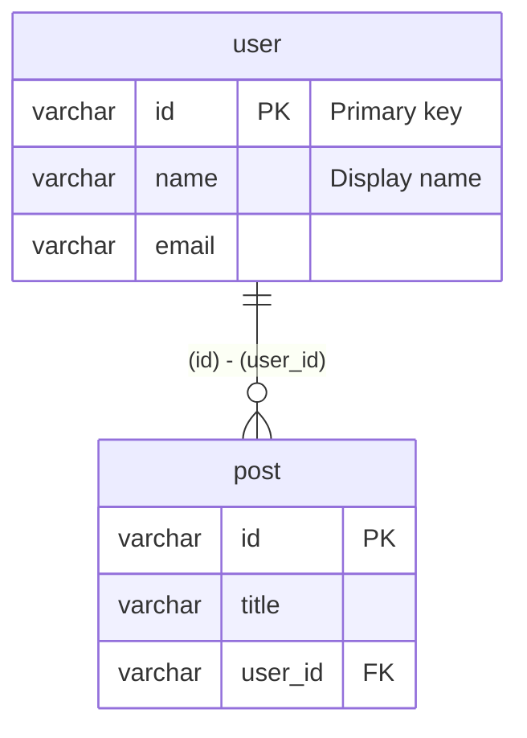
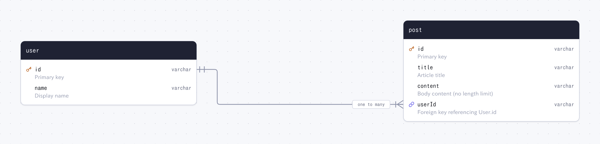

# Generating diagrams and DBML

## Command line

```text
drizzler [input...] -o <output> [options]
drizzler studio <input> [--port <port>] [--url <database-url>]
drizzler seed [--config <path>] [--url <database-url>] [--sql <file>] [--seed <n>] [--count <n>] [--locale <locale>] [--reset]
```

`input` is one or more files, directories or globs. Left out, drizzler reads the `schema` of
`drizzle.config.ts` (or `.mts`, `.js`, ...) in the current directory. The flags can come before or
after the input. A command line that cannot run (a missing `-o`,
an unknown format, a file that is not there) prints why and exits with code 1.

### Options

```text
-o, --output <path>               Output file (.md, .dbml, .svg, .png), or a directory for the docs
--theme <light|dark>              Colour scheme of the ER diagram
-p, --port <port>                 Port for drizzler studio (default: 4983)
-u, --url <database-url>          Database for drizzler studio (default: $DATABASE_URL)
-h, --help                        Display help message (drizzler studio --help, drizzler seed --help)
-v, --version                     Print the version
```

### Quick Start

```sh
# Write the docs: the table specification and every diagram, into docs/
npx drizzler db/schema.ts -o docs/

# Generate DBML
npx drizzler db/schema.ts -o docs/schema.dbml

# Generate ER diagram (SVG or PNG)
npx drizzler db/schema.ts -o docs/er.svg
npx drizzler db/schema.ts -o docs/er.png --theme dark

# Generate Mermaid ER diagram
npx drizzler db/schema.ts -o docs/ER.md

# Edit the schema, its ER diagram, docs and data in the browser
npx drizzler studio db/schema.ts --url file:./dev.db

# Fill the database with the rows drizzler.config.ts describes
npx drizzler seed
```

## Docs

Give a directory as the output (a trailing `/`, or a path with no extension) and drizzler writes
the schema's docs into it:

```sh
npx drizzler db/schema.ts -o docs/
```

| File                 | What it holds                                                                                                                                                                                                                                                                                                   |
| -------------------- | --------------------------------------------------------------------------------------------------------------------------------------------------------------------------------------------------------------------------------------------------------------------------------------------------------------- |
| `README.md`          | The table specification, as the studio's Docs page shows it: every table with its columns, constraints, defaults, indexes, relations both ways, `CREATE TABLE` definition and Drizzle queries with their SQL, and every enum, with the ER diagram on top and each related table's own diagram above its columns |
| `er.svg`             | The ER diagram (`--theme dark` for the dark one)                                                                                                                                                                                                                                                                |
| `tables/<table>.svg` | One diagram per table that has a relation: the table, the tables a relation joins it to, and those relations                                                                                                                                                                                                    |

Under each table, its queries are shown in Drizzle beside the SQL drizzle-orm builds for them, in
the schema's dialect: every row, how many, the rows with their relations, one row by its primary
key, and an insert, update and delete, with values of each column's type. To build that SQL,
drizzler loads the schema with the project's own drizzle-orm (through its proxy drivers, so nothing
connects to a database), resolving imports as it reads the schema (relative paths, `.js` for `.ts`,
the tsconfig's `paths`). Defaults the schema computes (`$defaultFn`, `$onUpdate`) see a fixed clock
and fixed random values, so the docs are the same on every run. Each table also shows its definition, and each enum
its type, as the project's drizzle-kit writes them (`CREATE TABLE`, its indexes and foreign keys);
the README opens with the whole schema's SQL, folded. When the schema cannot be loaded (drizzle-orm not installed, an import
that fails, Node.js older than 22.15), the docs are written with the queries as code only and no
definitions; without drizzle-kit, only the definitions are left out. Either way the reason is
printed.

Every description is the comment written above the table, column or enum. The Markdown is
written as the formatter would, so writing the docs again leaves no diff when nothing changed,
and the diagram of a table that is gone is removed from `tables/`.
[examples/layered/docs](https://github.com/nakita628/drizzler/tree/main/examples/layered/docs)
is such a directory.

## Schemas Split Over Files

Layered projects often keep one table per file, export the tables in a list, build them with a
casing helper, and share columns through a helper module:

```text
src/adapter/secondary/persistence/rdb/schema/
├── columns.helpers.ts   # const timestamps = { createdAt, updatedAt }
├── cart.sql.ts          # const cartTable = snakeCase.table("cart", { ..., ...timestamps })
├── cartItem.sql.ts      # .references(() => cartTable.customerId)
├── product.sql.ts
└── relations.sql.ts     # defineRelations({ ... }, (r) => ({ ... }))
```

```sh
# The schema drizzle-kit is configured with (schema: "./src/.../schema/*.sql.ts")
npx drizzler -o docs/er.svg

# Or name it: a directory, a glob, or several files
npx drizzler src/adapter/secondary/persistence/rdb/schema -o docs/er.svg
npx drizzler "src/**/schema/*.sql.ts" -o docs/ER.md
```

What drizzler reads across the files:

- every file given, and each project module they import or re-export, through relative paths and
  the tsconfig's `paths` (`#/*`, `@/*`); packages and `import type` are not followed, nor are test
  and declaration files in a directory
- tables declared plainly and exported in a list (`const user = pgTable(...); export { user };`)
  as well as `export const`
- `pgTable`, `sqliteTable`, `mysqlTable`, ..., `pgTable.withRLS`, and the `.table` of a casing or
  schema (`snakeCase.table`, `camelCase.table`, `pgSchema("auth").table`)
- columns spread from another object (`...timestamps`), with their comments, and the callback form
  `pgTable("user", (t) => ({ id: t.integer() }))`
- column builders without a name (`varchar({ length: 26 })`), named by their key

[examples/layered](https://github.com/nakita628/drizzler/tree/main/examples/layered) is such a
project, with its [ER diagram](https://github.com/nakita628/drizzler/blob/main/examples/layered/docs/er.png).

## Comments

A comment written directly above a table, a column or an enum is its description — in the DBML
notes, the Mermaid diagram, the ER diagram's cards and the studio's docs. Any TypeScript comment
will do: a JSDoc block, a block comment, or `//` lines.

```ts
/** Everyone who can sign in */
export const user = mysqlTable("user", {
  /** Primary key */
  id: varchar("id", { length: 36 }).primaryKey(),
  // Display name
  name: varchar("name", { length: 50 }).notNull(),
});
```

- The lines of a comment, or of a run of `//` lines, are joined into one description.
- A comment that ends a line of code (`id: int(), // ...`) belongs to that line, and one
  separated by a blank line (a file header) describes nothing.
- Lines starting with `@` are tags (`@deprecated`, ...), not description.

## Relation Detection

Drizzler detects relations from three sources. They are reflected consistently
across every ER output format (Mermaid, DBML, SVG and PNG).

### 1. `.references()` chain

```ts
userId: varchar("user_id").references(() => user.id);
```

### 2. `foreignKey()` constraint

```ts
export const post = pgTable('post', { ... }, (t) => [
  foreignKey({ columns: [t.userId], foreignColumns: [user.id] }),
])
```

The older object form, `(t) => ({ fk: foreignKey(...) })`, is read as well.

### 3. `defineRelations` (no foreign key required)

Relations are read as Drizzle's [relations v2](https://orm.drizzle.team/docs/relations) declare
them: every `defineRelations` and `defineRelationsPart` export, whatever it is named.

```ts
import { defineRelations } from "drizzle-orm";

export const post = pgTable("post", {
  id: uuid("id").primaryKey(),
  userId: uuid("user_id").notNull(), // no .references()
});

export const relations = defineRelations({ user, post }, (r) => ({
  post: { author: r.one.user({ from: r.post.userId, to: r.user.id }) },
  user: { posts: r.many.post() },
}));
```

Relations are not database constraints, so a relation with `from` and `to` is drawn even when no
foreign key backs it. Such an edge is dashed; when a `.references()` or `foreignKey()` backs the
same pair, it is drawn solid as that foreign key. The child side is "one or more" when its column
is `.notNull()` (or the `r.one` is `optional: false`), else "zero or more"; when that column is
a key of its own (`.primaryKey()`, `.unique()`, a one-column unique constraint) it is "one" or
"zero or one", a one-to-one. The same holds for a foreign key. Mermaid draws the ends as a
foreign key allows them: a parent has zero or more children (zero or one for a one-to-one), and a
child has one parent, or zero or one when its key column may be null.

`from` is not always the side that holds the key (`r.one.profile({ from: r.user.id, to:
r.profile.userId })`), so the child is the side whose column is a foreign key to the other; else
the side that is not a primary or unique key; else the one with an `...Id` name; else `from`.
A many-to-many through a junction table (`r.user.id.through(r.member.userId)`) is drawn as a key
from the junction to each end. A relation with no `from` / `to` adds nothing on its own: it is the
reverse side of a pair the other table declares.

## Output Examples

DBML and Mermaid name tables and columns as the database does: by the name given to `pgTable` (a
`pgTableCreator` prefix applied) and to each column, or in snake_case under `snakeCase.table`.
Their types are SQL types (`timestamptz`, `double precision`).

### DBML

```sh
npx drizzler db/schema.ts -o docs/schema.dbml
```

```dbml
Table user {
  id varchar [pk, not null, note: 'Primary key']
  name varchar [not null, note: 'Display name']
  email varchar [not null, unique]
  Note: 'Everyone who can sign in'
}

Table post {
  id varchar [pk, not null]
  title varchar [not null]
  user_id varchar [not null]
  indexes {
    (user_id) [name: 'post_user_idx']
  }
}

Ref post_user_id_user_id_fk: post.user_id > user.id
```

### Mermaid ER

```sh
npx drizzler db/schema.ts -o docs/ER.md
```



### ER Diagram (SVG / PNG)

```sh
npx drizzler db/schema.ts -o docs/er.svg
npx drizzler db/schema.ts -o docs/er.png --theme dark
```



Tables are laid out left to right along their relations. Each card shows its columns with
the primary key, foreign keys, `UK` for unique columns, `?` for nullable ones, defaults
(`.default()`, `.defaultNow()`, `$defaultFn()`, `$onUpdate()`), the comments' descriptions and the
indexes, unique and composite key constraints of the table. `pgEnum`s get a card of their own.
Edges use crow's-foot notation and name the relation and its `onDelete` / `onUpdate` action;
an edge declared only by `defineRelations` is dashed, since nothing in the database backs it.
